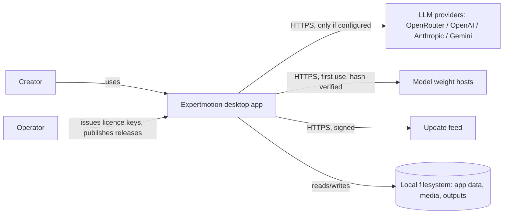
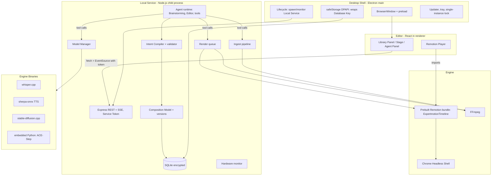
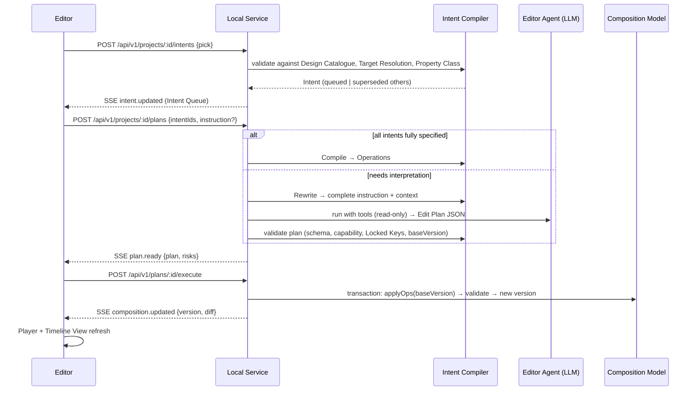
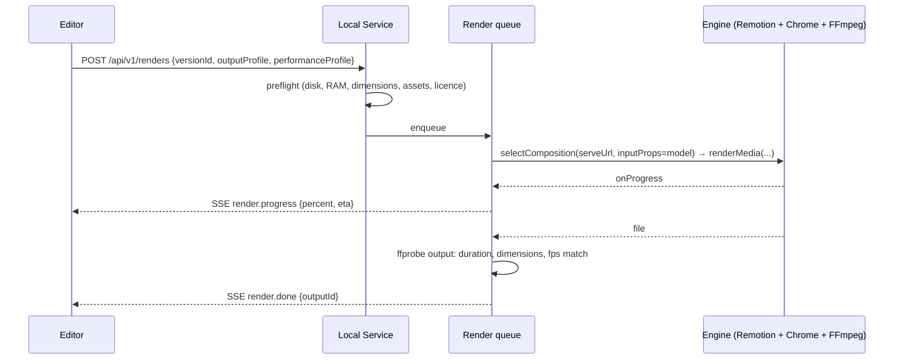

# Architecture

| Field | Value |
|---|---|
| Status | baseline |
| Owner | Principal architect |
| Last updated | 2026-10-25 |
| Depends on | GLOSSARY.md, DECISIONS.md, ASSESSMENT.md, PERFORMANCE.md |
| Used by | BLUEPRINT.md, TRD.md, API_SPECIFICATION.md, DATABASE_SCHEMA.md, AI_WORKFLOW.md, SECURITY.md, DEPLOYMENT_AND_PACKAGING.md, POC_PLAN.md |

## 1. Architecture in one paragraph

Expertmotion is one installed application made of three processes on the Creator's PC: the **Desktop Shell** (Electron main process: window, lifecycle, OS credential store, updater, tray), the **Local Service** (Node.js child process: Express HTTP + SSE on `127.0.0.1`, encrypted SQLite, Composition Model, Intent Compiler, agent runtime, render queue, Model Manager, hardware monitor), and the **Editor** (React web app in the Electron renderer, talking only to the Local Service with a per-launch Service Token). Rendering uses the **Engine**: a prebuilt Remotion bundle driven by `@remotion/renderer`, which spawns Chrome Headless Shell and FFmpeg as child processes. Local AI runs as separate **Engine Binaries** (whisper.cpp, sherpa-onnx, stable-diffusion.cpp, optional embedded Python) supervised by the Local Service. External LLM providers are reached only from the Local Service, only when configured, and never in Private Mode.

Pipeline (brief §10): **Editor → Edit Intent → validated Edit Plan → Composition Model → Remotion Adapter → Preview and Render → Output validation.**

## 2. C4 level 1: system context



No other outbound connections exist. Private Mode removes P, M and U.

## 3. C4 level 2: containers



### Container responsibilities

| Container | Responsibilities | Must not |
|---|---|---|
| Desktop Shell | create window; generate Service Token; spawn and supervise the Local Service (restart with backoff, max 3); wrap/unwrap the Database Key with `safeStorage`; single-instance lock; tray; updater; native dialogs (file pickers, open folder); crash reporter to local file | contain business logic; touch the database directly; expose Node to the renderer (`contextIsolation: true`, `nodeIntegration: false`, `sandbox: true`) |
| Local Service | everything stateful: DB, Composition Model, ingest, intents, agents, render queue, Model Manager, hardware monitor, licence verification | bind to anything but `127.0.0.1`; accept requests without the Service Token; run shell commands built from model output |
| Editor | presentation and interaction; optimistic UI only for selection state; Player preview with the same bundle code as render | compute or mutate Composition Model locally; call providers; keep secrets |
| Engine | render frames and stills; Player playback | be visible to the Creator as "Remotion" |
| Engine Binaries | one task per process (transcribe, synthesise, generate image/music) with files in and files out | network access (blocked by not passing proxies and by Private Mode checks before spawn) |

## 4. C4 level 3: Local Service modules (package boundaries in BLUEPRINT.md)

| Module | Package | Key interfaces |
|---|---|---|
| `http` | apps/service | Express app, auth middleware (Service Token, Host/Origin), `openSse`, error mapping to `EM-` codes |
| `db` | apps/service | migrations, repositories per table, transactions |
| `composition` | packages/composition-model | Zod schema of the Composition Model, pure `applyOperations(model, ops) → model` (wrapped by the service-level tool `composition.applyOps({planId})` from AI_WORKFLOW §8), `validate(model) → issues`, `deriveTiming(model, fps)`, version hashing |
| `catalogue` | packages/catalogue (React-free data: preset ids, labels, param Zod schemas, defaults, flags, Compile defaults) | Design Catalogue registry; `packages/engine` holds the React implementations keyed by preset id, so composition-model and agents can depend on the registry without a cycle |
| `intents` | packages/agents | Intent schema, Target Resolution, Property Classes, Intent Queue reducer, Compile, Rewrite, Locked Keys |
| `agents` | packages/agents | provider adapters (Vercel AI SDK), Brainstorming/Editor runners, tool registry with permissions, usage recording, context windowing |
| `ingest` | apps/service | probe (ffprobe), transcode, proxy, thumbnails, waveform, hash; job events |
| `render` | apps/service (ported RenderQueue) | queue, `selectComposition` + `renderMedia` with Output Profile and Performance Profile, cancel, ETA, output validation (ffprobe duration/dimensions/fps), thumbnail |
| `models` | packages/models | registry, download with hash/resume, engine process adapters (`transcribe`, `synthesize`, `generateImage`, `generateMusic`) |
| `hardware` | apps/service | tier detection, cheap meter, preflight checks |
| `license` | apps/service (bytecode-protected module) | Ed25519 verification, fingerprint, licence state, the `/api/v1` licence gate (EM-5010) and activation rate limit; no Trial Mode, no watermark |
| `settings` | apps/service | preferences, provider connections (encrypted), model assignments, Private Mode |

## 5. Process model and lifecycle

1. `Expertmotion.exe` starts → Shell acquires single-instance lock → reads/creates the wrapped Database Key via `safeStorage` → generates a 256-bit Service Token → picks a free loopback port (prefers 42300–42399; never a fixed well-known port) → starts the Local Service with Electron `utilityProcess.fork` (the `RunAsNode` fuse is off, so a plain Node child is not available) and passes `{token, port, dataDir, dbKey}` over the `parentPort`/`postMessage` channel (never argv or env, so they do not appear in process listings; SEC-002).
2. Local Service opens the encrypted DB, runs migrations, marks interrupted render jobs failed and interrupted agent runs cancelled, loads the licence state, detects the Hardware Tier, warms the browser (`ensureBrowser`) in the background, and reports `ready` over the parent port.
3. Shell loads the Editor (`app://` scheme in production, Vite dev server in development) and injects `{port, token}` via preload (`contextBridge`).
4. Editor opens `EventSource('/api/v1/events')` (all routes live under `/api/v1`, see API_SPECIFICATION.md) with the token in the query string (EventSource cannot set headers; the token is single-use-per-launch and loopback only) and uses `Authorization: Bearer <token>` on fetch.
5. On window close: Shell asks the Service to checkpoint; waits ≤ 5 s for running renders to cancel (prompting the Creator if one is running); sends `{type:'shutdown'}` over the parent port (fallback: kills the utility process when the 5 s close deadline passes, FR-002); exit.
6. Crash of the Service: Shell restarts it (backoff 1 s, 3 s, 9 s), Editor shows `sys.offline` and reconnects; render jobs are marked failed by the Service on restart.

## 6. Data flow: key sequences

### 6.1 Design Pick → Execute



### 6.2 Render



### 6.3 Ingest, model download: see ASSET_INGESTION.md and LOCAL_AI_MODELS.md (same job/SSE pattern).

## 7. Remotion Adapter

- One composition `ExpertmotionTimeline` registered in the Engine's `Root.tsx` with `calculateMetadata` deriving `width`, `height`, `fps`, `durationInFrames` from the Composition Model (ratio × resolution table, fps setting, Σ clips − Σ transition overlaps).
- `inputProps` = the Composition Model version (JSON, ≤ 2 MB) plus resolved asset URLs. Assets are served to Chrome Headless Shell by the Local Service at `/media/<grant>/<assetId>/<variant>` (API_SPECIFICATION.md §2.2, R-040…R-043); this is the **one documented exception** to the Service Token rule (ADR-005) because Chrome cannot add headers: the URLs carry a random media grant token in the path that is scoped to the current preview session or render job (issued and revoked by the Local Service; SEC-010), ids are unguessable ULIDs, the listener is loopback-only and read-only, and `Range` requests are supported. The Player uses the same URLs.
- Tracks render as stacked `AbsoluteFill`s; Clips use `<TransitionSeries>` on the video track; overlays/text/captions/audio use `<Sequence from durationInFrames>`; every preset is a React component keyed by `presetId` with a Zod params schema from the Design Catalogue.
- The bundle is built at package time (`bundle()` → `resources/engine/`) and served with `serveUrl` pointing at the bundle folder. No webpack at runtime.
- Preview: `@remotion/player` imports the same `ExpertmotionTimeline` component from `packages/engine`, so the Editor and the renderer share code; Draft mode swaps proxy URLs via a `quality` input prop.
- Parity testing (POC-002, TEST_PLAN): render stills of golden frames via `renderStill` and screenshot the Player at the same frame; pixel diff ≤ 1 %.

## 8. Filesystem layout (Windows)

```
%LOCALAPPDATA%\Programs\Expertmotion\   installed binaries (electron-builder NSIS per-user default; no admin prompt)
%APPDATA%\Expertmotion\
  data\expertmotion.db      encrypted SQLite (+ -wal, -shm)
  data\checkpoints\         Composition Model snapshots (JSON, last 20 per project)
  media\<projectId>\<assetId>\original.<ext> | proxy.mp4 | thumb.jpg | wave.json
  outputs\<projectId>\      rendered files + thumbs
  models\<engine>\<model>\  downloaded weights + .sha256 + manifest.json
  engine\chrome\            Chrome Headless Shell (copied from install on first run if needed)
  logs\service.log, shell.log, diagnostics-*.zip
  settings.json             non-secret UI preferences (theme, window bounds)
```

The Database Key never touches disk unwrapped; it lives wrapped in `data\keyring.bin` via `safeStorage` (DPAPI, current Windows user).

## 9. Cross-cutting concerns

| Concern | Approach |
|---|---|
| Errors | every failure maps to an `EM-xxxx` code with EN/ID copy and a recovery action; stack traces only in logs/diagnostics |
| Logging | structured JSON lines; secrets redacted by pattern (`sk-`, `Bearer`, provider key shapes); 7-day rotation |
| Versioning | Composition Versions are immutable and hashed; plans reference `baseVersion`; undo/redo move the project head pointer |
| Concurrency | one render at a time **globally** (queue; EM-3208 when busy); one agent run per agent per project (409 on conflict); ingest parallelism 2 |
| Memory | Performance Profile ceilings; render concurrency; Chrome killed on cancel; `mediaCacheSizeInBytes` per profile |
| Offline | everything except providers/downloads/updates; Private Mode enforces it at the HTTP client layer (single egress module) |
| i18n | i18n keys; EN default; ID variants for content/errors/tour |
| Testing seams | Composition Model and Intent Compiler are pure functions; provider adapters behind an interface with a fake; Engine behind `RenderAdapter` with a fake for unit tests |

## 10. Shell comparison summary (details in ASSESSMENT.md §5)

Electron was selected (ADR-004) because Remotion documents it, the preview Chromium matches the render Chromium, native modules ship prebuilds, and signing/updating tooling is mature. Tauri would save ~100 MB RAM but adds a sidecar packaging problem and a WebView2 parity risk; Node SEA cannot provide a window, tray or keychain; Neutralino and Bun lack the ecosystem or verified Remotion support.

## 11. Open architectural questions (tracked in RISKS_AND_ASSUMPTIONS.md)

1. Remotion v5 telemetry vs Private Mode (ADR-017).
2. Whether to serve media to Chrome via HTTP or `file://` (HTTP chosen for Player parity; revisit if render speed suffers).
3. Embedded Python footprint for music (P2).
