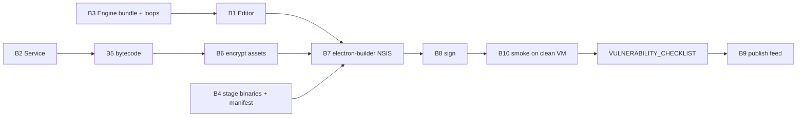

# Deployment and packaging

| Field | Value |
|---|---|
| Status | baseline (Windows x64; macOS/Linux in Appendix A are P2, PRD-055) |
| Owner | DevSecOps engineer / desktop packaging |
| Last updated | 2026-10-25 |
| Depends on | GLOSSARY.md, DECISIONS.md (ADR-004, 007, 008, 011, 013, 014, 017), ARCHITECTURE.md (§5, §7, §8), ASSESSMENT.md (§4, §5, §10), PERFORMANCE.md (§5 budgets), SECURITY.md, LICENSE_OPERATIONS.md, BLUEPRINT.md (repo layout) |
| Used by | ROADMAP.md, STAGE_MANAGEMENT.md, VULNERABILITY_CHECKLIST.md, POC_PLAN.md, TRD.md, DEVELOPMENT_WORKFLOW.md, QA_PROCESS.md |
| Owner of | build pipeline, installer behaviour, update flow, release artefact naming, build-machine requirements, size budget |
| ID range | steps are numbered B1 … B10; no requirement ids (controls live in SECURITY.md) |

Sources accessed 2026-10-24: Remotion Electron guide https://www.remotion.dev/docs/electron; Chrome Headless Shell https://www.remotion.dev/docs/miscellaneous/chrome-headless-shell; `ensureBrowser` https://www.remotion.dev/docs/renderer/ensure-browser; `renderMedia` options https://www.remotion.dev/docs/renderer/render-media; electron-builder configuration https://www.electron.build/docs/configuration, NSIS https://www.electron.build/docs/nsis, auto-update https://www.electron.build/docs/features/auto-update, code signing https://www.electron.build/docs/features/code-signing/; Electron fuses https://www.electronjs.org/docs/latest/tutorial/fuses; ASAR integrity https://www.electronjs.org/docs/latest/tutorial/asar-integrity; electron-vite source protection https://electron-vite.org/guide/source-code-protection; Windows code signing https://learn.microsoft.com/en-us/windows/apps/package-and-deploy/code-signing-options and SmartScreen https://learn.microsoft.com/en-us/windows/apps/package-and-deploy/smartscreen-reputation; npm registry (package existence and latest versions): `@remotion/compositor-win32-x64-msvc` 4.0.538, `electron-builder` 26.15.3, `electron-updater` 6.8.9, `@electron/fuses` 2.1.3, `better-sqlite3-multiple-ciphers` 13.0.3, `bytenode` 2.0.0, `@cyclonedx/cyclonedx-npm` 6.0.1, `argon2` 0.45.1, `electron` 45.0.0.

## 1. Toolchain decision: Vite + esbuild + electron-builder

| Option | Builds | Installer/updater | Fuses/ASAR integrity | Bytecode | Verdict |
|---|---|---|---|---|---|
| **Vite (Editor) + esbuild (Shell main/preload, Local Service) + electron-builder (NSIS)** | three independent bundles, each with the simplest tool for its target | NSIS per-user, `electron-updater` with `latest.yml`, blockmap differential downloads, `verifyUpdateCodeSignature` | `@electron/fuses` in `afterPack`; `asar: true` with `asarUnpack` for native modules and Engine Binaries | `bytenode` for two Service modules | **selected** |
| electron-vite + electron-builder | one config for main/preload/renderer | same | same | built-in `build.bytecode` (main + preload) | fallback if `bytenode` fails POC-006; rejected now because its preload bytecode requires `sandbox: false` (we keep `sandbox: true`, SEC-022) and because the Local Service is not an Electron "main" bundle |
| Electron Forge + Vite (Remotion template baseline) | plugin-based | Squirrel.Windows by default; NSIS via maker | `@electron-forge/plugin-fuses` | none built-in | rejected: `electron-updater` requires NSIS; Squirrel lacks the publisher-signature check and the keep-data uninstall prompt |

Rationale: the Editor is a plain web app (ADR-004 consequence: it must run in a browser in development), so Vite is the natural tool and the predecessor's Vite setup is ported (ADR-013). The Local Service is a Node program that must be one file with externalised native modules; esbuild does that in one command. electron-builder is the only packager that gives NSIS, per-user installs, signed differential updates and `verifyUpdateCodeSignature` together.

Repository targets (ADR-013, BLUEPRINT.md): `apps/ui` (Editor) → `apps/desktop/dist/ui/`; `apps/service` → `apps/desktop/dist/service/`; `packages/engine` → `apps/desktop/resources/engine/`; `apps/desktop` holds the Shell source, `electron-builder.yml`, `build/installer.nsh`, `build/afterPack.cjs`, `build/sign.cjs`, icons and licence text. `apps/desktop` is the only package electron-builder sees.

## 2. Build pipeline (B1 … B10)

All steps run from the repository root with `npm run release:win` on the Windows build machine (§10). Each step is also runnable alone for debugging. Versions come from `apps/desktop/package.json` (single source; workspaces are bumped together).

| Step | Command (script name) | Input | Output | Notes |
|---|---|---|---|---|
| **B1 Editor** | `npm run build -w apps/ui` (Vite `build`, `sourcemap: false`, `base: './'`) | `apps/ui/src`, `packages/engine` (Player imports `ExpertmotionTimeline`) | `apps/desktop/dist/ui/` (`index.html`, hashed `assets/*.js` and `assets/*.css`, fonts, catalogue loop files from B3) | Served via `app://expertmotion/` (SEC-025). CSP meta tag injected here (SEC-024). i18n JSON included. |
| **B2 Local Service** | `npm run build -w apps/service` (esbuild: `--bundle --platform=node --format=cjs --target=node22 --minify --sourcemap=false --external:better-sqlite3-multiple-ciphers --external:argon2 --external:@remotion/renderer --external:@remotion/compositor-* --external:bytenode`) | `apps/service/src`, `packages/*` | `apps/desktop/dist/service/service.cjs` + `node_modules` subset for externals (copied by electron-builder `files`) | `@remotion/renderer` stays external because it resolves the compositor package and Chrome paths at runtime relative to its own location in `app.asar.unpacked`. CJS because `bytenode` and the utility process load CJS reliably. |
| **B3 Engine** | `npm run build -w packages/engine` (`bundle({entryPoint: 'src/index.ts', outDir: 'apps/desktop/resources/engine', publicDir: 'public'})` from `@remotion/bundler`; then `renderCatalogueLoops.ts`: for each Design Preset in DESIGN_CATALOGUE.md, `selectComposition` + `renderMedia({codec:'vp8', …, scale})` to a 2 s 480 px webm into `apps/desktop/dist/ui/catalogue/<presetId>.webm`) | `packages/engine/src`, `public/fonts`, catalogue registry | `resources/engine/` (prebuilt Remotion bundle, `serveUrl` at runtime), `dist/ui/catalogue/*.webm` (≤ 40 MB total, PERFORMANCE.md §5) | No webpack at runtime (ADR-001, ADR-011). Loop rendering needs Chrome Headless Shell on the build machine (`ensureBrowser()` first). |
| **B4 Engine Binaries** | `npm run stage:binaries` (Node script) | `node_modules/.remotion/chrome-headless-shell/win64/` (version from its `VERSION` file; Remotion 4.0.534+ pins Chrome 157.0.8080.0), `node_modules/@remotion/compositor-win32-x64-msvc/` (FFmpeg/ffprobe + compositor; package name confirmed on npm 2026-10-24, exact binary file names inside it **[UNVERIFIED]**), `vendor/win64/whisper/`, `vendor/win64/sherpa-onnx/`, `vendor/win64/sd/` (prebuilt, built or downloaded by the Operator, signed in B8) | `apps/desktop/resources/engine/chrome/…`, `resources/engine/compositor/…`, `resources/bin/whisper/…`, `resources/bin/sherpa-onnx/…`, `resources/bin/sd/…`, `resources/engine-manifest.json` (path, sha256, vendor-signed yes/no, `network:false`) | Remotion's compositor FFmpeg is a slim build (output codecs only); ingestion of AV1/HDR/FLAC/ProRes sources needs a separate **full FFmpeg** build staged at `resources/bin/ffmpeg-full/` (ASSESSMENT.md §4, ASSET_INGESTION.md §3). Licence handling: use an **LGPL-configured** build (no `--enable-gpl`, no `--enable-nonfree`; libx264 is therefore excluded from the full build and H.264 encoding stays with the compositor) so Expertmotion links nothing GPL; record the exact build flags, source URL and sha256 in `vendor/win64/NOTICES/ffmpeg-full.md` and in Third-Party Notices (§11). The embedded Python runtime for music (P2) is **not** bundled; downloaded on demand through the Model Manager (ADR-008, SEC-070–075). Remotion requires binaries outside `app.asar`: the Service passes `browserExecutable` and `binariesDirectory` from `process.resourcesPath` (Remotion Electron guide). |
| **B5 Bytecode** | `npm run protect:bytecode` (`bytenode.compileFile({filename:'dist/service/license.cjs', output:'dist/service/license.jsc', electron:true, electronPath:'node_modules/electron/dist/electron.exe'})`; same for `prompts.cjs`) | the two modules split out of B2 by esbuild `splitting` is not available in CJS, so they are built as separate esbuild entries and `require`d by `service.cjs` through the `bytenode` loader | `license.jsc`, `prompts.jsc`; `.cjs` sources deleted | Only Local Service main-thread modules. **Never** the Editor, the preload, or anything under `resources/engine` (`Function.prototype.toString` is needed by Remotion; ADR-007, SEC-131). Must be compiled with the exact Electron that ships (V8 version lock); the script asserts `electron --version` equals the pinned version. Compatibility with the pinned Electron is verified in POC-006. |
| **B6 Encrypt prompt/preset assets** | `npm run protect:assets` | `SYSTEM_PROMPT.md`-derived JSON, Design Preset descriptors | `dist/service/assets.enc` (AES-256-GCM) | Key material: half in `prompts.jsc`, half a build constant injected with esbuild `define` (SEC-132). Raises cost only. |
| **B7 Package** | `npx electron-builder --win nsis --x64 --publish never` with `apps/desktop/electron-builder.yml` | everything above | `release/<version>/Expertmotion-Setup-<version>-win-x64.exe`, `.blockmap`, `latest.yml`, unpacked `win-unpacked/` for tests | Configuration in §3. `afterPack` flips fuses (SEC-028) and writes `engine-manifest.json` hashes; electron-builder embeds the ASAR header hash as the `Integrity`/`ElectronAsar` resource when `asar: true` and the integrity fuse is set (ASAR integrity doc). |
| **B8 Sign** | automatic inside B7 via `win.signtoolOptions` (or `win.sign` custom hook) | OV certificate on a hardware token or CA cloud-HSM | every PE signed and RFC 3161 timestamped | OV, not EV (EV no longer buys SmartScreen reputation); Azure Artifact Signing is not available to organisations outside US/CA/EU/UK (Microsoft, accessed 2026-10-24), so an OV certificate from a CA is used. Since June 2023 OV private keys must live on an HSM/token, so a `.pfx` in CI is not an option for a newly issued certificate: sign on the build machine with the token, or use the CA's cloud signing service via a custom `sign` hook. Vendor-signed binaries (Chrome Headless Shell, compositor) are not re-signed. |
| **B9 Publish feed** | `npx electron-builder --publish always` or manual upload | `release/<version>/` | `https://<release-host>/expertmotion/win/latest.yml` + installer + blockmap (provider `generic`), or GitHub Releases (provider `github`) | Feed host pinned in the binary (SEC-096). `latest.yml` carries `sha512`; the updater verifies the Authenticode signature too (SEC-091). Staged rollout via `stagingPercentage` optional. |
| **B10 Smoke test** | `npm run smoke:vm` (PowerShell over WinRM to a clean VM snapshot) | installer | pass/fail report in `release/<version>/smoke.md` | Install as standard user → launch → onboarding → import 3 clips → Insert → one transition → Execute (Compile path, no provider) → Export 10 s 1080p → ffprobe the output → uninstall (keep data) → reinstall → project still there. Then VULNERABILITY_CHECKLIST.md. |

### Build order and gates



The feed is published only after B10 and the checklist pass. Nothing is published from a developer laptop.

## 3. electron-builder configuration (reference)

```yaml
# apps/desktop/electron-builder.yml
appId: com.expertmotion.desktop
productName: Expertmotion
artifactName: Expertmotion-Setup-${version}-win-${arch}.${ext}
directories: { output: ../../release/${version}, buildResources: build }
asar: true
asarUnpack:
  - "**/node_modules/better-sqlite3-multiple-ciphers/**"
  - "**/node_modules/argon2/**"
  - "**/node_modules/@remotion/renderer/**"
  - "**/node_modules/@remotion/compositor-win32-x64-msvc/**"
files:
  - dist/**
  - package.json
  - "!**/*.map"
  - "!**/*.ts"
  - "!**/*.tsx"
  - "!**/test/**"
  - "!**/.env*"
extraResources:
  - { from: resources/engine, to: engine }
  - { from: resources/bin, to: bin }
  - { from: resources/engine-manifest.json, to: engine-manifest.json }
  - { from: resources/THIRD_PARTY_NOTICES.txt, to: THIRD_PARTY_NOTICES.txt }
afterPack: build/afterPack.cjs        # flips fuses with @electron/fuses, verifies manifest hashes
npmRebuild: true                      # rebuild native modules for the pinned Electron
win:
  target: [{ target: nsis, arch: [x64] }]
  verifyUpdateCodeSignature: true
  signtoolOptions:
    publisherName: "<exact certificate subject CN>"
    rfc3161TimeStampServer: "<CA timestamp URL>"
    signingHashAlgorithms: [sha256]
    # certificateSubjectName / certificateSha1 select the token-held cert; or `sign: build/sign.cjs`
nsis:
  oneClick: false
  perMachine: false
  allowElevation: false
  allowToChangeInstallationDirectory: true
  deleteAppDataOnUninstall: false       # the keep/delete prompt is in build/installer.nsh
  differentialPackage: true
  createDesktopShortcut: true
  createStartMenuShortcut: true
  runAfterFinish: true
  license: build/EULA.txt
  include: build/installer.nsh
  uninstallDisplayName: Expertmotion ${version}
publish:
  - { provider: generic, url: "https://<release-host>/expertmotion/win" }
```

`electronFuses` also exists as a top-level electron-builder key; its sub-option names were not confirmed on 2026-10-24 (**[UNVERIFIED]**), so `afterPack` with `@electron/fuses` (`flipFuses(exePath, {version: FuseVersion.V1, [FuseV1Options.RunAsNode]: false, [FuseV1Options.EnableCookieEncryption]: true, [FuseV1Options.EnableNodeOptionsEnvironmentVariable]: false, [FuseV1Options.EnableNodeCliInspectArguments]: false, [FuseV1Options.EnableEmbeddedAsarIntegrityValidation]: true, [FuseV1Options.OnlyLoadAppFromAsar]: true, [FuseV1Options.GrantFileProtocolExtraPrivileges]: false})`) is the reference implementation (fuse names confirmed on the Electron fuses page).

## 4. Pinned versions (one table; TRD.md copies it)

| Component | Pin rule | Where recorded |
|---|---|---|
| Electron | exact version in `apps/desktop/package.json`; bytecode and native modules are rebuilt on every bump | `package.json`, `releases/<v>/toolchain.txt` |
| Node (build machine) | 22.x LTS exact (Remotion requires 20.19+/22.13+/24+ per the book; the official system-requirements page returned 404 in ASSESSMENT §4 **[UNVERIFIED]**) | `.nvmrc`/`.node-version` |
| `remotion`, all `@remotion/*`, `@remotion/compositor-win32-x64-msvc` | one exact version everywhere (predecessor convention; VC-43) | root `package.json` `overrides` |
| Chrome Headless Shell | the version Remotion's `VERSION` file pins for the pinned Remotion; copied, never downloaded at runtime (`ensureBrowser` is called only at build) | `engine-manifest.json` |
| electron-builder, electron-updater, @electron/fuses, bytenode, argon2, better-sqlite3-multiple-ciphers | exact | lockfile |
| Engine Binaries (whisper.cpp, sherpa-onnx, stable-diffusion.cpp) | git tag + sha256 of the prebuilt; rebuilt or re-downloaded by the Operator only | `vendor/win64/VERSIONS.md`, `engine-manifest.json` |

## 5. Installed layout (Windows)

```
%LOCALAPPDATA%\Programs\Expertmotion\          per-user install (electron-builder NSIS default per-user location [UNVERIFIED exact path]; ARCHITECTURE.md §8 shows %LOCALAPPDATA%\Expertmotion\app and must be aligned)
  Expertmotion.exe                              Desktop Shell (signed, fuses set, ASAR integrity resource)
  Uninstall Expertmotion.exe                    signed
  *.dll, locales\, resources\                   Electron runtime
  resources\app.asar                            Shell main, preload, dist\ui (Editor), dist\service (service.cjs, *.jsc, assets.enc)
  resources\app.asar.unpacked\node_modules\     better-sqlite3-multiple-ciphers, argon2, @remotion\renderer, @remotion\compositor-win32-x64-msvc
  resources\engine\                             prebuilt Remotion bundle (serveUrl), chrome\win64\... (Chrome Headless Shell), compositor\ (FFmpeg/ffprobe)
  resources\bin\whisper\ | sherpa-onnx\ | sd\   Engine Binaries (Operator-signed)
  resources\engine-manifest.json                paths + sha256 + network flags (SEC-061)
  resources\THIRD_PARTY_NOTICES.txt
%APPDATA%\Expertmotion\                         data (ARCHITECTURE.md §8): data\expertmotion.db, data\keyring.bin, data\checkpoints\, media\, outputs\, models\, tmp\, logs\, settings.json
```

Everything under `%LOCALAPPDATA%\Programs\Expertmotion` is replaced by updates and never written by the running app; everything under `%APPDATA%\Expertmotion` belongs to the Creator and is never touched by the installer or updater (SEC-093) except on an explicit "delete my data" at uninstall.

## 6. Per-user install (decision)

**Install-folder ACL (found on a Windows 11 ThinkPad, 2026-10-25):** Electron's sandboxed processes read the install folder with an AppContainer token. When the inherited ACL of `%LOCALAPPDATA%\Programs` carries an AppContainer package SID but no `ALL APPLICATION PACKAGES` (S-1-15-2-1) entry, Windows denies the sandbox and Electron exits before any window or log (`install_dir_access.cc ... Grant it with icacls`). The installer (`apps/desktop/installer/expertmotion.nsi`) therefore runs `icacls "$INSTDIR" /grant *S-1-15-2-1:(OI)(CI)(RX)` on its own folder (read/execute only, no administrator rights). Manual fix on an already installed PC: `icacls "%LOCALAPPDATA%\Programs\Expertmotion" /grant "*S-1-15-2-1:(OI)(CI)(RX)"`.

| Criterion | Per-user (`perMachine: false`) — **selected** | Per-machine |
|---|---|---|
| Admin prompt | none; standard users can install (SEC-069) | UAC at install and at every update (electron-updater does not auto-install per-machine builds without elevation) |
| Updates | silent, signed, differential, no elevation | needs elevation; staged installs break |
| Multi-user PCs | each Windows user installs their own copy (~400 MB each) | one copy, but data and DPAPI are per user anyway |
| SmartScreen | identical | identical |
| Enterprise deployment | not a target persona | would be preferable |

Justification: the Creator persona is a single person on their own laptop (PRD §2); the data model is per-user by construction (DPAPI); avoiding UAC removes the most common support ticket for Electron apps and keeps updates silent. `allowElevation: false` guarantees the installer never asks. A per-machine MSI can be added later for businesses (P2).

Installer behaviour (`oneClick: false`): welcome → EULA (BRD) → install location (default per-user; changeable) → progress → "Launch Expertmotion" checked. Installer language: English with Indonesian strings for the two custom pages (ADR-012), via `installerLanguages` **[option name confirmed; Indonesian language pack availability UNVERIFIED]**.

## 7. Size budget (installer ≤ 450 MB per PERFORMANCE.md §5; app data baseline ≤ 200 MB)

| Component | Uncompressed estimate | Source of the number | Notes |
|---|---|---|---|
| Electron runtime (exe, dlls, locales, Chromium resources) | 110–130 MB | typical Electron 3x win-x64 **[estimate]** | compresses ~2.5× in NSIS LZMA |
| Editor bundle (B1) incl. fonts and i18n | 8–15 MB | predecessor Vite build scale | catalogue loops counted separately |
| Catalogue preview loops (B3) | ≤ 40 MB | PERFORMANCE.md §5 budget | webm, 2 s, 480 px; incompressible |
| Local Service bundle + externals | 15–25 MB | esbuild output + `@remotion/renderer` | |
| Engine bundle (`resources/engine`) | 10–20 MB | Remotion bundle of one composition + presets | |
| Chrome Headless Shell win64 | ~100 MB | ASSESSMENT §4 **[UNVERIFIED; Remotion states no size]** | largest single item |
| Compositor package (FFmpeg/ffprobe/compositor) | 40–70 MB | slim FFmpeg build **[estimate]** | |
| whisper.cpp (CPU + optional Vulkan) | 5–15 MB | prebuilt release sizes **[estimate]** | models not included |
| sherpa-onnx (TTS) | 20–40 MB | onnxruntime included **[estimate]** | P1; may ship with the first P1 release instead |
| stable-diffusion.cpp | 10–40 MB | **[estimate]** | P2; ship when thumbnails land |
| **Total installed (MVP: without sd.cpp)** | **≈ 360–460 MB** | | **Installer: ≈ 300–400 MB compressed before models [estimate]; budget ≤ 450 MB; measured in POC-001** |
| Model weights (downloaded) | 0.5–7 GB per model | LOCAL_AI_MODELS.md | never in the installer (ADR-008) |

Size wording is unified across ADR-004, ASSESSMENT §10, PERFORMANCE §5 and this table: installer ≈ 300–400 MB compressed before models, budget ≤ 450 MB, measured in POC-001 (the component estimates above are uncompressed; NSIS LZMA compression of the Electron runtime is the main saving, Chrome Headless Shell and the webm loops compress little).

## 8. First-run tasks (Desktop Shell + Local Service, in order)

| # | Task | Owner | Failure → |
|---|---|---|---|
| 1 | `app.requestSingleInstanceLock()`; second instance focuses the first | Shell | exit silently |
| 2 | Create `%APPDATA%\Expertmotion\{data,media,outputs,models,tmp,logs}` | Shell | EM-6xxx dialog, exit |
| 3 | `safeStorage.isEncryptionAvailable()`; generate Database Key (`randomBytes(32)`), wrap, write `data\keyring.bin` (first run only) | Shell | EM-6xxx dialog, exit (SEC-040) |
| 4 | Generate Service Token, pick port 42300–42399, `utilityProcess.fork(service.cjs)`, `postMessage` bootstrap (SEC-002, SEC-008) | Shell | retry ×3 with backoff, then EM-8xxx |
| 5 | Verify `engine-manifest.json` hashes (SEC-061) | Service | affected feature disabled, logged |
| 6 | Open DB (`PRAGMA key`, `cipher`), run migrations, mark interrupted jobs failed | Service | `.bak` fallback, else recovery screen (DATABASE_SCHEMA §7) |
| 7 | Hardware Tier detection (PERFORMANCE §1); RAM < 8 GB warning | Service | T0 default |
| 8 | Browser check: `Chrome Headless Shell` present and executable from `resources\engine\chrome`; `ensureBrowser({browserExecutable})` is **not** allowed to download (no network) — presence only | Service | EM-3001-class preflight error at Export, app usable |
| 9 | Licence state load (no key → `unlicensed`: the Editor shows only the licence screen, LICENSE_OPERATIONS §7) | Service | Licence screen |
| 10 | `ready` → Shell loads `app://expertmotion/` and shows onboarding (PRD-018) | Shell | — |
| 11 | After the Editor is interactive and Private Mode is off: one update check (SEC-094) | Shell | logged, silent |

## 9. Updates

| Aspect | Behaviour |
|---|---|
| Library | `electron-updater` (`autoUpdater` from `electron-updater`), NSIS target, `autoDownload: false`, `allowDowngrade: false`, `channel: 'latest'` |
| Check | at launch (after interactive) and every 24 h; never in Private Mode (SEC-094) |
| Offer | `update-available` → the Shell starts the download in the background (FR-152) when `downloadDecision` allows: Private Mode off, connection not reported metered (Electron has no metered API: unknown does not block), no Render Job running; otherwise it waits and re-evaluates every 5 min. The `sys.update` banner shows progress and keeps a manual Download while waiting |
| Download | `downloadUpdate()`; differential via `.blockmap` when the previous installer is cached; `download-progress` shown; download continues in the background; aborted if a render starts (resource policy) and resumed later |
| Verify | `latest.yml` `sha512`; Authenticode signature chain + `publisherName` match (`verifyUpdateCodeSignature`), failure → `error`, file deleted (SEC-091) |
| Install | `update-downloaded` → "Restart to update" or `autoInstallEvent: 'onQuit'` — installs when the Creator quits, never while a render runs (Shell asks the Service whether a job is running first) |
| Data | `%APPDATA%\Expertmotion` untouched; DB migrations run on next start with a `.bak` copy (DATABASE_SCHEMA §5) |
| Interrupted install | NSIS copies into the install directory only after the download is complete and verified. If the process dies mid-copy: the Shell writes `pending-update.json` before `quitAndInstall()`; on next launch, if the marker exists and `app.getVersion()` is still the old version or the integrity check fails on start (SEC-133 would terminate the app), the Shell offers **Repair**: re-download the installer and run it. If the app cannot start at all, the Start Menu "Repair Expertmotion" shortcut (installer with `/S` re-run from the cached installer in `%LOCALAPPDATA%\expertmotion-updater\`) restores the last downloaded version. Data is never at risk because the updater never touches `%APPDATA%`. |
| Interrupted install (as built) | `apps/desktop/src/main.ts` writes `<data>/update-pending.json` `{fromVersion, toVersion, at}` before `quitAndInstall()`; at the next launch `pendingUpdateOutcome` (updater-policy.ts) compares it with `app.getVersion()`: still `fromVersion` → EM-8104 in `sys.update` with Try again (new check + download), `toVersion` or newer → applied; the marker is then removed (ignored after 7 days). What only the installer can do: keep the previous file set launchable until the new one is complete (NSIS per-user install, atomic swap), and never touch `%APPDATA%`. Feed URL and publisher name stay Operator placeholders (`__EM_FEED_URL__`, `win.signtoolOptions.publisherName`). |
| Rollback | Operator publishes the previous build as a higher patch version; Creators receive it as a normal update (SEC-095) |
| Release notes | `releaseNotes` in `latest.yml`, shown in the banner's "What's new" |

## 10. Build machine and CI

| Requirement | Local build machine | GitHub Actions alternative |
|---|---|---|
| OS | Windows 10/11 x64 (22H2+) | `windows-latest` runner |
| Node | 22.x LTS exact (`.nvmrc`) | `actions/setup-node` with the same version and `cache: npm` |
| RAM / disk | 16 GB RAM; ~20 GB free (Electron downloads, Chrome Headless Shell, catalogue loop renders, `win-unpacked`, installer) | runner default (7 GB RAM, 14 GB SSD) is tight: skip loop rendering on CI by committing loops as release assets, or use a larger runner |
| Tools | Git, Windows SDK `signtool.exe` (installed by electron-builder's winCodeSign download otherwise), 7-Zip optional, Hyper-V or VirtualBox for the clean VM | signtool present on `windows-latest` |
| Certificate | OV certificate on a USB token (CA/B Forum HSM rule) or CA cloud-HSM account | tokens cannot be attached to hosted runners → use the CA's cloud signing CLI in a `win.sign` hook, with its API credentials in GitHub **Environment secrets** (`SIGN_API_USER`, `SIGN_API_KEY`, `SIGN_TOTP_SECRET` or equivalent) scoped to a protected `release` environment that requires manual approval; **never** a `.pfx` in secrets for a new OV cert. If a legacy exportable certificate exists, electron-builder reads `WIN_CSC_LINK` (base64 of the `.pfx`) and `WIN_CSC_KEY_PASSWORD` (confirmed env names). |
| Feed credentials | release-host SSH/S3 credentials on the build machine only | `GH_TOKEN` (provider `github`) or S3/generic credentials as environment secrets |
| Network | needed for `npm ci`, Electron download, Chrome Headless Shell (`ensureBrowser`) | same |
| Clean VM | snapshot "Win11-clean-std-user" without dev tools | not available on hosted runners → B10 runs on the Operator's machine |

Build steps on CI mirror §2; artefacts (`release/<version>/`) are uploaded with `actions/upload-artifact` and published only after the manual B10 + checklist approval.

## 11. Reproducibility, SBOM, notices

| Practice | Rule |
|---|---|
| Lockfile | `package-lock.json` committed; `npm ci` only; `npm install` on the build machine is a release blocker |
| Toolchain pin | `.nvmrc`; `electron`, `electron-builder`, `@remotion/*` exact; `releases/<v>/toolchain.txt` records `node -v`, `npm -v`, `npx electron --version`, Chrome `VERSION`, compositor version |
| Deterministic inputs | `SOURCE_DATE_EPOCH` set from the commit time for archives; Vite/esbuild `define` constants from `package.json` only |
| Two-build check | VC-123: two builds from the same commit produce identical unsigned file hashes |
| SBOM | `npx @cyclonedx/cyclonedx-npm --output-file release/<v>/sbom.json` (CycloneDX JSON), plus a hand-maintained `sbom-binaries.json` for non-npm binaries (Chrome Headless Shell, whisper.cpp, sherpa-onnx, sd.cpp) with version, sha256, licence, source URL |
| Third-Party Notices | `npm run notices` collects npm licences (`license-checker-rseverything` or equivalent) + `vendor/win64/NOTICES/*` (full FFmpeg LGPL build flags and the compositor FFmpeg's notice, Chrome for Testing terms, whisper.cpp MIT, sherpa-onnx Apache-2.0, GPL-3 text and source offer for the espeak-ng phonemizer inside the sherpa-onnx TTS binary (and piper1-gpl if ever shipped, ADR-009), model licences from LOCAL_AI_MODELS.md) into `resources/THIRD_PARTY_NOTICES.txt`; shown in Help ▸ About |
| Hashes | `SHA256SUMS` over every artefact in `release/<v>/`, signed with the Operator's release GPG/SSH key (optional, for power users) |

## 12. Release artefact naming

| Artefact | Name |
|---|---|
| Installer | `Expertmotion-Setup-<semver>-win-x64.exe` |
| Blockmap | `Expertmotion-Setup-<semver>-win-x64.exe.blockmap` |
| Feed | `latest.yml` (channel `latest`); `beta.yml` for the beta channel |
| Hashes | `SHA256SUMS` |
| SBOM | `sbom.json`, `sbom-binaries.json` |
| Notices | `THIRD_PARTY_NOTICES.txt` (also inside the installer) |
| Checklist and evidence | `VULNERABILITY_CHECKLIST.md`, `evidence/` (not published) |
| Git tag | `v<semver>` on `main`, signed |

Version scheme: semver; `MAJOR` for Composition Model schema breaks (with migration), `MINOR` for features/presets, `PATCH` for fixes. Licence update-eligibility compares the release date in `latest.yml` (LICENSE_OPERATIONS.md).

## 13. Uninstall behaviour

| Step | Behaviour |
|---|---|
| Entry | Windows Settings ▸ Apps, or Start Menu "Uninstall Expertmotion" |
| Running instance | uninstaller asks to close Expertmotion; refuses to continue while a render is running |
| Program files | removed from `%LOCALAPPDATA%\Programs\Expertmotion` and the updater cache |
| Data prompt (custom page in `installer.nsh`, `customUnInstall` macro **[macro name UNVERIFIED]**) | "Keep my projects, media and settings (recommended if you plan to reinstall)" (default) / "Delete everything in %APPDATA%\Expertmotion, including rendered videos" — the second option names the folder size |
| Keep | `%APPDATA%\Expertmotion` untouched; reinstall finds everything, including `keyring.bin` (same Windows user) |
| Delete | folder removed recursively; `keyring.bin` gone, so the DB would be unrecoverable anyway |
| Licence | the Licence Key remains valid for this Machine Fingerprint (LICENSE_OPERATIONS.md); the Creator is told to keep the key email |
| Registry | only the uninstall entry and the `expertmotion://` protocol registration (if used for licence activation links) are removed |

## 14. Crash diagnostics (local only)

| Process | Capture | Location | Sent anywhere? |
|---|---|---|---|
| Shell | `process.on('uncaughtException')` → redacted stack + `about.json` | `logs\crash-shell-<ts>.txt` | never (SEC-104) |
| Local Service | same; the Shell restarts it (backoff 1 s, 3 s, 9 s; then `sys.offline` with Repair/Restart actions) | `logs\crash-service-<ts>.txt` | never |
| Editor renderer | `render-process-gone` event → reload once, then error page with EM-8xxx and "Open diagnostics" | `logs\shell.log` | never |
| Chrome Headless Shell / FFmpeg | stderr tail (last 200 lines, redacted) attached to the failed Render Job | DB `render_jobs.error`, `logs\engine.log` | never |
| Creator action | Help ▸ Diagnostics → bundle with consent (SEC-102, SEC-103) | `logs\diagnostics-<ts>.zip` | only by the Creator's own means |

Electron's `crashReporter` is either not started or started with `uploadToServer: false`; minidumps stay in `%APPDATA%\Expertmotion\logs\crashpad\` and are pruned with the 7-day rotation.

## 15. What cannot be done on the Linux development server

| Task | Why not | Where instead |
|---|---|---|
| Run or test Electron | no display, 1.9 GB RAM, shared tenant (ASSESSMENT §1) | Windows laptop / VM |
| Build the NSIS installer with signing | OV token/cloud signing is Windows tooling; electron-builder can cross-build NSIS under Wine but not sign with a token | Windows build machine or CI |
| Compile bytecode for Windows Electron | bytecode is bound to V8 version **and CPU architecture**; cross-platform validity x64 Linux → x64 Windows is **[UNVERIFIED]**, so compile on Windows | Windows |
| Stage Windows Engine Binaries | win64 downloads are possible, but execution/hash verification of behaviour is not | Windows |
| Render catalogue loops | needs Chrome Headless Shell + ≥ 1 GB headroom; the server cap is 900 MB soft | Windows (or commit loops) |
| Full renders, parity tests, resource measurements | memory cap | Windows (POC-001/002/007) |
| What **can** run here | unit tests of `packages/composition-model`, `packages/agents`, service HTTP tests with supertest (POC-010 parts), fake-provider tests (POC-004 parts), kill-9 persistence tests (POC-005 parts), small stills under the cgroup cap | this server |

## 16. Model CDN on Cloudflare R2 (Operator runbook, ADR-026)

Operator decision 2026-10-25: Creators' apps download Local Model files **only** from the Operator's own CDN, a Cloudflare R2 bucket served on a custom domain (free tier: 10 GB storage, no egress fees). Cloudflare Pages / Workers static assets are not used: they cap a single file at 25 MB. The app never contacts Hugging Face for a Creator; the Operator mirrors the files once with `tools/model-mirror` (LOCAL_AI_MODELS.md §4.5).

How the app uses it: the release build bakes `EM_MODEL_CDN_URL` into the Local Service (B2, `apps/service/scripts/build.mjs` define `__EM_MODEL_CDN_URL__`, read by `apps/service/src/services/model-cdn.ts`). With it, the model-download allow-list is exactly the CDN host (SEC-071), and the Service fetches `<cdn>/models.json` + `<cdn>/models.json.sig` at most once per 24 h (and on Model Manager refresh, R-147), verifies the Ed25519 signature with the embedded manifest public key (SEC-072) and only then saves it into the models folder. Model files are `<cdn>/m/<sha256>` (opaque names; the manifest carries the original file name, size, sha256 and the Hugging Face revision). Without `EM_MODEL_CDN_URL` the build is a development build and `scripts/release-check.mjs` refuses to release it.

### 16.1 One-time setup

1. **Manifest signing key** (offline signing PC; separate from the licence key, LICENSE_OPERATIONS.md key inventory): `node tools/license-cli/src/cli.mjs keygen --kid M1 --seal --out <path outside any repository>/manifest-M1.key.json` (passphrase from `EXPERTMOTION_LICENSE_PASSPHRASE` or `--passphrase-file`). Set the printed public key hex as `EM_MANIFEST_PUBLIC_KEY_M1_HEX` when building the release (injected by `apps/service/scripts/build.mjs`; no source edit). Back the key file up like the licence key.
2. **Bucket**: Cloudflare dashboard → R2 → Create bucket (e.g. `expertmotion-models`, location automatic, Standard storage class).
3. **Public access**: bucket → Settings → Custom Domains → Connect Domain → e.g. `models.<your-domain>` (the domain's DNS must be on Cloudflare). For a quick test only, the bucket's `r2.dev` public URL can be enabled; Cloudflare rate-limits `r2.dev` and does not intend it for production, so release-check refuses an `r2.dev` URL.
4. **API token for uploads**: R2 → Manage R2 API Tokens → Create API token, permission "Object Read & Write", limited to this bucket. Note the Access Key ID, Secret Access Key and the S3 endpoint `https://<account-id>.r2.cloudflarestorage.com`.
5. **rclone remote** (`rclone config`, or `~/.config/rclone/rclone.conf`):

   ```
   [r2]
   type = s3
   provider = Cloudflare
   access_key_id = <Access Key ID>
   secret_access_key = <Secret Access Key>
   endpoint = https://<account-id>.r2.cloudflarestorage.com
   acl = private
   no_check_bucket = true
   ```

   rclone uploads files larger than its `upload_cutoff` (200 MiB by default) as S3 multipart uploads, which every file over 300 MB needs: `wrangler r2 object put` uploads a single object of at most 300 MB, so it cannot upload the Whisper, SD 1.5 or FLUX files.

### 16.2 Each model update (rotate `seq` every time)

```
node tools/model-mirror/mirror.mjs prepare --out D:\em-mirror --cdn https://models.<your-domain> [--only whisper-small,whisper-large-v3-turbo] [--revision revisions.json]
node tools/model-mirror/mirror.mjs sign --out D:\em-mirror --key E:\keys\manifest-M1.key.json
node tools/model-mirror/mirror.mjs verify --out D:\em-mirror
rclone copy D:\em-mirror\m r2:expertmotion-models/m --s3-chunk-size 64M --transfers 2 --checksum --progress
rclone copy D:\em-mirror r2:expertmotion-models --include "/models.json" --include "/models.json.sig" --header-upload "Cache-Control: no-cache"
```

- `prepare` downloads each file once (streamed to disk while hashing, resumable: run it again after an interruption), keeps it as `m/<sha256>` and writes `models.json` with `seq` = previous `seq` + 1 (or `--seq N`); it removes an old `models.json.sig`, so `sign` must follow. Keep the `--out` folder between updates: unchanged files are not downloaded again and `seq` keeps increasing. The Service refuses a manifest whose `seq` is lower than the last one it accepted (`stale`).
- Pin revisions: `--revision revisions.json` maps a model key or Hugging Face repo to a 40-hex commit (`{"ggerganov/whisper.cpp": "<commit>"}`); without it the tool records the `x-repo-commit` header Hugging Face sends and resumes from that commit. Gated repositories need `HF_TOKEN` in the environment (sent to `huggingface.co` only).
- Licences: models with `licence.redistribution: 'no'` are never mirrored; `'verify'` (the Piper voices, RISK-002) only with `--include-verify` after the Operator has verified the dataset licence. The tool prints why each model is skipped.
- Upload `m/` first and the two manifest files last, back to back: an app that checks between the two uploads sees a pair that does not verify, keeps its current list (EM-7111) and picks the new one up on its next check. Never delete an `m/<sha256>` object that a manifest still in use references; remove old objects only after every supported app version has moved on.
- The upload credentials stay on the Operator's machine (rclone config); nothing in the repository or the binary can write to the bucket.

### 16.3 Free-tier budget (registry sizes, decimal GB, estimates until pinned)

| Model | Size | Mirrored by default |
|---|---|---|
| whisper-small | 0.49 GB | yes |
| whisper-medium | 1.53 GB | yes |
| whisper-large-v3-turbo | 1.62 GB | yes |
| whisper-large-v3 | 3.10 GB | yes |
| kokoro-82m-v1.0 | 0.09 GB | yes |
| sd15-emaonly | 4.30 GB | yes |
| flux1-schnell-q4 (4 files) | 12.25 GB | yes |
| piper-id-news-medium, piper-en-lessac-medium | 0.06 GB each | only with `--include-verify` |
| ace-step-v1-3.5b (≈ 7 GB), loop-library-cc0 (≈ 0.15 GB) | — | no file list in the registry yet |
| stable-audio-open-1.0 | — | never (`redistribution: 'no'`, evaluate only) |

Everything mirrorable comes to ≈ 23.4 GB (23.5 GB with the Piper voices), so the full set does **not** fit the 10 GB free tier: FLUX.1-schnell alone (12.25 GB) exceeds it, and whisper-large-v3 + sd15-emaonly + the three smaller Whisper models already reach ≈ 11 GB. A free-tier set is, for example, `--only whisper-small,whisper-medium,whisper-large-v3-turbo,kokoro-82m-v1.0,sd15-emaonly` plus the Piper voices once verified (≈ 8.2 GB); `prepare` warns when the total exceeds 10 GB. Storage above 10 GB and the per-month operation allowances are billed by Cloudflare; check the current R2 pricing page before adding FLUX or whisper-large-v3 (not verified here). Egress has no fee.

### 16.4 Release build

Set `EM_MODEL_CDN_URL=https://models.<your-domain>` (no trailing path needed; a path prefix such as `/v1` is allowed) in the environment of `npm run release:win`. `scripts/release-check.mjs` stops while it is unset, the placeholder, `http://`, an example host or `r2.dev`. With it set, `TO_PIN` lines in `packages/models/src/registry.ts` are reported as a note only: the signed CDN manifest pins every file, and the built-in Hugging Face URLs are outside the allow-list. Upload a signed `models.json` before shipping, otherwise every model stays "not available yet" (EM-7110).

## Appendix A. macOS and Linux (P2, PRD-055)

| Topic | macOS | Linux |
|---|---|---|
| Target | `dmg` + `zip` (zip needed by electron-updater), arm64 and x64 (or universal: requires both compositor packages, per the Remotion Electron guide) | `AppImage` (updater-capable) + `deb`; `glibc` vs `musl` compositor variants (`@remotion/compositor-linux-x64-gnu` / `-musl`, names confirmed on the Remotion page) |
| Signing | Apple Developer ID ($99/yr), `hardenedRuntime: true`, entitlements for JIT (Electron) and for child binaries; **every** embedded Mach-O signed (Chrome Headless Shell, FFmpeg, whisper, sherpa-onnx), then notarization (`notarytool`) and stapling | optional GPG signature of AppImage; `allowUnverifiedLinuxPackages` left `false` |
| Secrets | `safeStorage` uses Keychain | `safeStorage` may fall back to `basic_text`; `getSelectedStorageBackend()` checked; refuse or warn (SEC-040) |
| Fuses / ASAR integrity | supported (ASAR integrity since Electron 16 on macOS) | ASAR integrity **not** supported on Linux (Electron doc lists macOS and Windows only) → rely on AppImage immutability and signatures |
| Engine Binaries | mac-arm64 / mac-x64 Chrome Headless Shell; universal builds double the size | linux64 Chrome Headless Shell needs system libraries (Remotion lists them) |
| Hardware acceleration | VideoToolbox (`hardwareAcceleration`) | NVENC with driver ≥ 525 |
| Open questions | Gatekeeper behaviour for child binaries spawned from `resources/`; notarization of the sherpa-onnx TTS binary that embeds the GPL-3 espeak-ng phonemizer | sandboxing (`--no-sandbox` must **not** be used; AppImage + Chromium sandbox needs user namespaces) |
