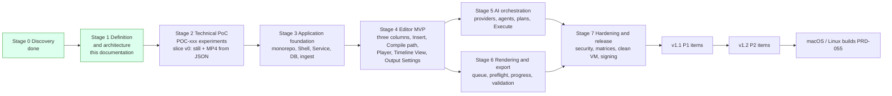

# Roadmap: Stages 0–7, post-MVP releases, milestones

| Field | Value |
|---|---|
| Status | baseline (estimates are estimates, not commitments) |
| Owner | Engineering manager |
| Last updated | 2026-10-24 |
| Depends on | MASTER_PROJECT_PROMPT.md §17, §18, §24; GLOSSARY.md; PRD.md; ARCHITECTURE.md; AI_WORKFLOW.md; DESIGN_CATALOGUE.md; PERFORMANCE.md; DECISIONS.md; ASSESSMENT.md §1 |
| Used by | STAGE_MANAGEMENT.md, POC_PLAN.md, DEVELOPMENT_WORKFLOW.md, TEST_PLAN.md, process.md |
| ID range | none (stages are `Stage 0` … `Stage 7`; milestones `M0` … `M9`) |

This document says **what is built in which order and why**. How a stage is opened, reviewed and closed is in `STAGE_MANAGEMENT.md`; how code is written is in `DEVELOPMENT_WORKFLOW.md`; what "done" means is in `DEFINITION_OF_DONE.md`; how it is tested is in `QA_PROCESS.md` and `TEST_PLAN.md`. Requirements are referenced by `PRD-` id and never restated here.

## 1. Planning assumptions

| Assumption | Value |
|---|---|
| Capacity | **1 developer (the Operator) + AI coding agents.** Agents write most code and tests; the developer reviews, runs verification on real hardware, signs, and decides. The binding constraint is human verification time, not typing speed. |
| Unit of estimate | developer-week (dw) = 5 focused developer days including agent supervision. Estimates carry a confidence level: **high** (± 25 %), **med** (± 50 %), **low** (could double). |
| Calendar dates | none. Stages are sequenced by dependency; the Operator decides pace. |
| Environments | Linux dev server (`/home/andre/expertmotion`, 1.9 GB RAM, 2 CPUs, headless, memory cgroup soft 900 MB / hard 1.2 GB, render concurrency 1, ports 4100+ only; ASSESSMENT.md §1) for headless packages; a Windows 10/11 machine (reference laptop T0, optional T2 desktop) for Electron, packaging, full renders and QA; a clean Windows VM for installer tests; optional Windows CI runner later. |
| Priorities | `PRD.md` §4 (P0 all in v1.0; P1 in v1.1; P2 in v1.2+). Provisional ADR-008/009/016 are assumed accepted until the Operator says otherwise. |
| Vertical slice first | Inside Stages 2–4 the **P0 vertical slice** (import 1 clip → one transition → render MP4) is built end to end before any breadth (brief §24). Breadth (full P0 catalogue, agents, onboarding) comes after the slice is demonstrably working on Windows. |

## 2. Stage overview and dependency graph

Stages 5 and 6 share Stage 4 as a prerequisite and can be interleaved; with one developer they run sequentially, Stage 6 first (the slice's render path is already partly built in Stage 2–4 and the release depends on it more than on agents).

## 3. Where each stage can run

| Stage | Linux dev server (headless, capped) | Windows machine / clean VM | Why |
|---|---|---|---|
| 0, 1 | yes | — | documentation only |
| 2 | POC experiments on `packages/composition-model`, `packages/engine` (stills at ≤ 720p, 1–2 s MP4 at concurrency 1), fake-provider structured output, encrypted SQLite | packaging, Electron launch, Chrome Headless Shell + FFmpeg distribution, `safeStorage`, memory measurements on T0 | Electron cannot build or run without a display and > 1.9 GB RAM (ASSESSMENT.md §1) |
| 3 | `apps/service` (all unit and integration tests with fake Engine), `apps/ui` in a browser through an SSH tunnel, migrations, ingest with small fixtures | `apps/desktop`, Shell↔Service lifecycle, DPAPI key wrapping, installer | — |
| 4 | Editor in browser against the Service, Compile path, catalogue golden frames at reduced resolution | Player parity screenshots, catalogue loop build (≤ 40 MB), golden frames at full resolution | memory cap |
| 5 | everything (fake provider replay; optional live provider runs with a test key) | none required | agents are pure Node |
| 6 | queue logic, preflight, output validation with fake Engine and 1–2 s real renders | render matrix, Performance Profiles, Chrome kill test, cancel test | real renders exceed the cap |
| 7 | security unit tests, dependency audit, docs | everything else: clean VM, signing, installer, updater, usability | release target is Windows |

Rule: any Remotion render on the Linux server runs under `npm run dev:capped` or `systemd-run` with the cgroup values above, at `concurrency: 1`, one job at a time, ≤ 720p, ≤ 5 s, and the cgroup `memory.current` is read before and after (DEVELOPMENT_WORKFLOW.md §4).

## 4. Stages

### Stage 0 — Discovery and repository assessment (done)

| Field | Content |
|---|---|
| Objectives | Inspect the predecessor repository, mockup, book and Remotion resources; identify constraints; document assumptions and risks (brief §18). |
| Scope | Foundation for PRD-021; inputs to all PRD items. |
| Dependencies | none |
| Tasks (completed) | Inventory of `/home/andre/experthinker-studio`; mockup inspection; book extraction; Remotion docs, licence, Elements, Electron template review; packaging options; storage and credential options; local model licences; provider APIs. |
| Deliverables | `docs/ASSESSMENT.md`, `docs/GLOSSARY.md`, `docs/ELEMENT_IDS.md`, `docs/DECISIONS.md` (ADR-001…017), `memory.md`, `process.md` entry 1, git repository. |
| Risks surfaced | Remotion licence for end-user renders (RISK-001, ADR-017); Electron size and RAM (RISK-005); code protection limits (RISK-008); Indonesian TTS quality (RISK-002); dev server capacity (RISK-015). |
| Tests | none (documentation); verification = files exist, sources cited with access dates. |
| Acceptance criteria | ASSESSMENT.md separates facts from `[UNVERIFIED]` items; every finding has a source. **Met.** |
| Entry / exit | Entry: brief received. Exit: ADRs 001–017 recorded; glossary frozen. **Exited 2026-10-24.** |
| Effort | 1 dw actual. |
| Blockers | none |

### Stage 1 — Product definition and architecture (this documentation)

| Field | Content |
|---|---|
| Objectives | Finalise MVP requirements, stack, boundaries, contracts, security and threat models, the editor interaction model (brief §18). |
| Scope | PRD-001…021 defined; PRD-030…056 listed; out-of-scope list (PRD §4.4). |
| Dependencies | Stage 0 |
| Tasks | Write every document in `docs/INDEX.md`; consistency pass and traceability matrices; `AGENTS.md`, `CLAUDE.md`, `.claude/` wiring; Haiku dry run of the AI workflow against the schemas in AI_WORKFLOW.md §3 (fake provider, no code). |
| Deliverables | All `docs/*.md` listed in INDEX.md with status `baseline`; `SYSTEM_PROMPT.md` v1; traceability matrices filled. |
| Risks | Documentation drift between concurrently written documents (mitigation: consistency pass, GLOSSARY frozen, "reference never redefine"); provisional ADR-008/009/016 unconfirmed. |
| Tests | Traceability checks in INDEX.md (every `el:` in FRD and UI spec; every FR has ≥ 1 `QA-`; every P0 maps to a stage task and a test); link check of `docs/`. |
| Acceptance criteria | A fresh agent, given only the repository, can state the next task and the contracts it must honour (PRD-021 hand-over test). |
| Entry / exit | Entry: Stage 0 exited. Exit: INDEX.md matrices show no `pending`; Operator sign-off on ADR-008/009/016 or explicit "proceed as provisional"; process.md entry. |
| Effort | 2 dw, **high** confidence (mostly complete). |
| Blockers | Operator confirmation of provisional ADRs (does not block Stage 2 start, blocks Stage 3 scope for Tools). |

### Stage 2 — Technical proof of concept

| Field | Content |
|---|---|
| Objectives | Retire the highest-risk assumptions with the smallest experiments (brief §23 D, §18): desktop packaging, runtime startup, minimal Remotion composition from JSON, preview and render parity, native dependency distribution, structured AI output, resource consumption. Produce **slice v0**: a hard-coded Composition Model with one Clip and one `preset:transition.fade` rendered to MP4 by the prebuilt bundle, inside a packaged Electron app on Windows. |
| Scope | De-risks PRD-001, PRD-004, PRD-009, PRD-010, PRD-013, PRD-014, PRD-016, PRD-019; no Creator-facing UI. |
| Dependencies | Stage 1 contracts: `DATABASE_SCHEMA.md` §4 (Composition Model), `AI_WORKFLOW.md` §3 (schemas), `PERFORMANCE.md` §3 (pixel table), `POC_PLAN.md` (POC- experiments). |
| Tasks | 1. Create the monorepo skeleton (npm workspaces, TypeScript strict, Vitest) with empty `apps/desktop`, `apps/service`, `apps/ui`, `packages/composition-model`, `packages/engine`, `packages/agents`, `packages/models`, `packages/shared` (BLUEPRINT.md layout). 2. `packages/composition-model`: Zod schema v1, `applyOps` for `op:clip.insert` and `op:transition.set` only, `deriveTiming`, hash. 3. `packages/engine`: `ExpertmotionTimeline` with `video` track, `<TransitionSeries>`, `fade` and `none`, `calculateMetadata` from the pixel table; `Root.tsx`; `scripts/build-engine.ts` producing `resources/engine/` (prebuilt bundle). 4. POC render path: `selectComposition` + `renderMedia` with `serveUrl` = bundle folder, `inputProps` = model; `renderStill` for parity frames. 5. POC Electron (Windows): electron-vite app that spawns a Node child (`apps/service` stub) with token over stdin, loads a static page, triggers the render, shows progress over SSE. 6. POC native deps: `better-sqlite3-multiple-ciphers` with `PRAGMA key` inside Electron; Chrome Headless Shell + FFmpeg located via `binariesDirectory`/`browserExecutable` from `resources/`. 7. POC packaging: electron-builder NSIS installer, ASAR with `resources/` unpacked where needed, install on a clean VM, launch, render. 8. POC structured output: `packages/agents` provider adapter (Vercel AI SDK + OpenRouter) returning `EditPlan` JSON validated by Zod, with a fake provider for tests; measure validity on 5 hand-written envelopes. 9. POC resources: measure idle RAM, render peak RAM, installer size, cold start on T0; write numbers into PERFORMANCE.md "to confirm" rows. 10. POC `safeStorage` wrap/unwrap of the Database Key; behaviour when DPAPI is unavailable. 11. UX: clickable static prototype of flows F2, F3, F8 (UXRD.md §7) for UT round 1 (optional if time-boxed; does not gate exit). **POC_PLAN.md mapping**: task 7 = POC-001 (packaging), task 4 = POC-002 (parity), task 6 = POC-003 (native dependencies), task 8 = POC-004 (AI structured output), task 10 + kill tests = POC-005 (persistence and recovery), ASAR/bytecode/source-map check = POC-006 (artefact security), task 9 = POC-007 (resource consumption), POC-009 (`swangle` effects on a GPU-less machine) added to task 3, POC-010 (Service Token and Host guard) added to task 5; POC-008 (whisper.cpp prebuilt) is a P1 risk and runs only if time allows. |
| Deliverables | `POC_PLAN.md` results table filled with actual numbers; slice v0 installer (`Expertmotion-poc-0.0.x.exe`) and a recorded demo; PERFORMANCE.md budgets confirmed or revised; ADR notes for anything that changed (for example if `file://` media serving is needed, ARCHITECTURE.md §11.2). |
| Risks | Electron + Headless Shell memory on 8 GB machines (RISK-005, RISK-014); bytecode/ASAR breaking the renderer path (ADR-007, RISK-008); native module ABI mismatch with Electron and antivirus false positives on binaries (POC-003, RISK-028); model variance in structured output (RISK-017, RISK-011); preview-to-render parity (RISK-029); Remotion licence (RISK-001). |
| Tests | POC acceptance checks per `POC_PLAN.md`; `QA-` cases in TEST_PLAN.md §2 (packaging) and §13 (golden frames) run in their minimal form; composition-model unit tests for the two ops. |
| Acceptance criteria | On a clean Windows VM without dev tools: install, launch, render slice v0 to a valid MP4 (ffprobe: 1920×1080, 30 fps, expected duration ± 1 frame). Parity: `renderStill` frame vs Player screenshot pixel diff ≤ 1 % at 3 frames. Structured output: ≥ 4 of 5 envelopes return schema-valid `EditPlan` on first attempt with a mid-tier model, 5 of 5 after ≤ 2 re-prompts. Encrypted DB opens only with the key. Resource numbers recorded. |
| Entry criteria | Stage 1 exited; Windows machine available with Node 22, a code-signing certificate **not** required yet. |
| Exit criteria | All POC- experiments have a recorded result (pass / fail / changed decision); any failed experiment has an ADR or a revised plan; process.md entry; demo recording; Operator sign-off (STAGE_MANAGEMENT.md). |
| Effort | 3–4 dw, **med** confidence. |
| Blockers | Access to a Windows machine (hard blocker for tasks 5–7, 9, 10); OpenRouter test key with a small budget (task 8). |

### Stage 3 — Application foundation

| Field | Content |
|---|---|
| Objectives | Build the desktop launcher, the local application lifecycle, persistence with migrations, the base UI and design system, and asset import with validation (brief §18). Promote slice v0 to **slice v1**: a real Project with a real imported Asset, inserted as a Clip, persisted in the encrypted DB, surviving a restart. |
| Scope | PRD-001 (foundation), PRD-003, PRD-004, PRD-005, PRD-015 (error mapping), PRD-016 (Service Token, Host/Origin, Electron hardening), PRD-019 (tier detection), PRD-020 (egress module), PRD-021. |
| Dependencies | Stage 2 results; `API_SPECIFICATION.md`, `DATABASE_SCHEMA.md`, `ASSET_INGESTION.md`, `ERROR_CATALOGUE.md`, `SECURITY.md`, `UI_UX_SPECIFICATION.md`, `ACCESSIBILITY_AND_I18N.md`. |
| Tasks | **apps/desktop**: main process (single-instance lock, window, preload with `contextBridge` exposing `{port, token}` only, `safeStorage` key wrapping, spawn/supervise Service with backoff 1/3/9 s and max 3, graceful close with ≤ 5 s render cancel, tray, crash log, `app://` protocol). **apps/service**: Express app with auth middleware (Bearer token, Host/Origin allow-list, JSON size limits), `openSse` (ported), error mapping to `EM-` codes, structured JSON logging with secret redaction; `db/` with `better-sqlite3-multiple-ciphers`, migrations `001_*.sql` from DATABASE_SCHEMA.md §3, repositories; startup recovery (mark `rendering` jobs failed, `running` agent runs cancelled); checkpoint writer (autosave 10 s, max 20 files); `hardware/` tier detection and cheap meter; `settings/` with encrypted provider credential fields and Private Mode flag; single egress module (`packages/shared/src/egress.ts`) that every outbound call must use; `ingest/` probe (ffprobe), validation per ASSET_INGESTION.md, transcode (HEVC → H.264), proxy 720p, thumbnails, waveform, hash, job events. **apps/ui**: Vite + React 19 + Tailwind v4; design tokens from UI_UX_SPECIFICATION.md; i18n keys with `en.json`/`id.json` and the lint for UX-040/041; API client with token; SSE store (ported); shell layout with the three columns and Header (empty panels), `data-el` attributes for every `el:` id; `sys.offline`, `sys.toast`; File menu: New, Open, Save, Save As, Recent, Project Settings, Recover dialog. **packages/shared**: `HttpError`, `newId` (ulid), `sha256`, `sanitizeFilename`, `formats.ts` (7 ratios, safe areas, `detectFormat` extended), `fit.ts` (`fitText`, ported). **Tests**: service integration tests with a fake Engine; migration tests on an empty and a seeded DB; ingest tests per supported container with 2 s fixtures; auth tests (no token → 401, wrong Origin → 403). |
| Deliverables | Installable dev build on Windows that opens a Project, imports assets, inserts one Clip (slice v1), restarts cleanly, recovers from a kill; `apps/ui` running in a browser on the Linux server against the Service; CI-equivalent script `npm run verify` (typecheck + lint + test) green on both environments. |
| Risks | DPAPI tying data to the Windows user (RISK-018, ADR-006 trade-off; document backup path); FFmpeg transcode time on T0 (no RISK id yet; measured in Stage 3); scope creep into Stage 4 UI (RISK-010; mitigation: Stage 3 UI is shell + File menu only). |
| Tests | TEST_PLAN.md §3 (lifecycle and recovery), §4 (projects), §5 (ingestion), §16 (security: auth, path restrictions), §13 minimal golden frame for slice v1. |
| Acceptance criteria | PRD-003 (kill mid-edit → recover ≤ 10 s old checkpoint), PRD-004 (DB unreadable without key), PRD-005 (unsupported file shows an `EM-1xxx` reason; HEVC MOV transcoded and plays in a plain `<video>`), auth tests pass, `npm run verify` green, memory on Linux dev server measured ≤ 900 MB soft cap during the full test suite. |
| Entry criteria | Stage 2 exited; API_SPECIFICATION.md and DATABASE_SCHEMA.md at `baseline`. |
| Exit criteria | Slice v1 demo recording on Windows; all Stage 3 `QA-` cases pass or have an accepted deviation; process.md and memory.md updated; Operator sign-off. |
| Effort | 4–6 dw, **med** confidence. |
| Blockers | Windows machine for `apps/desktop`; ERROR_CATALOGUE.md codes for ingest (EM-1xxx) and system (EM-6xxx) must exist before the error mapping is written. |

### Stage 4 — Editor MVP

| Field | Content |
|---|---|
| Objectives | The three-column Editor with asset ordering, basic composition, Player preview, Timeline View, the P0 Design Catalogue, the deterministic Compile path, and Output Settings (brief §18). No LLM yet: every pick is a Design Pick → Edit Intent → Compile → Composition Version. Promote slice v1 to **slice v2**: import 3 clips, order them 2-3-1, Insert, pick `preset:transition.slide` on all Cuts, pick a caption style with an SRT, preview, render 9:16 1080p. |
| Scope | PRD-002, PRD-006, PRD-007, PRD-008, PRD-009, PRD-012 (Compile half), PRD-013, PRD-017 (licence state read; Trial Mode watermark flag), PRD-019 (tier gating in Output Settings). |
| Dependencies | Stage 3; `DESIGN_CATALOGUE.md` (P0 set), `REMOTION_CAPABILITY_MAP.md`, `AI_WORKFLOW.md` §4–7 (Target Resolution, Property Classes, Compile), `EDITOR_INTERACTION_MODEL.md`, `ELEMENT_IDS.md`. |
| Tasks | **packages/composition-model**: full schema v1 (Tracks `video/overlay/text/caption/audio`, all Timeline Element kinds), `applyOps` for every P0 op in AI_WORKFLOW.md §5 (`clip.*`, `transition.*`, `text.*`, `caption.importSrt/setStyle/clear`, `background.*`, `motion.*`, `easing.setDefault`, `effect.*`, `shape.*`, `audio.addBed/addLayer/setDucking/remove`, `theme.set`, `output.*`, `project.*`), `validate(model)` invariants (DATABASE_SCHEMA.md §4.4), `deriveTiming`, `migrateModel` stub. **packages/engine**: catalogue registry `src/catalogue/<category>.ts` (Zod params, defaults, labels EN/ID, tags, flags) for every P0 preset; preset components per category (transitions via `@remotion/transitions`; captions via `@remotion/captions` + `CaptionPage`; backgrounds; motion via `interpolate`/`spring`; shapes via `@remotion/shapes`; effects via `@remotion/effects`; audio via `@remotion/media`; text variants with `fitText`, `KineticText` (ported), `@remotion/rough-notation`); bundled fonts (`public/fonts`); `scripts/build-catalogue-loops.ts` (2 s, 480 px webm per preset, ≤ 40 MB total); `scripts/golden-frames.ts` (renderStill fixtures per preset × 7 ratios). **packages/agents** (`intents/` only, no provider): `EditIntent` builder, Target Resolution table, Property Class reducer with supersede/restore, Locked Keys, Compile table (category → ops) with one unit test per P0 preset. **apps/service**: routes `POST /projects/:id/intents`, `POST /projects/:id/plans` (Compile branch), `POST /plans/:id/execute` (transaction: `applyOps(baseVersion)` → `validate` → new version → checkpoint), `GET /projects/:id/composition`, `/media/:assetId` loopback server, undo/redo head pointer, licence state endpoint (reads `license` module stub; Trial Mode by default). **apps/ui**: Library Panel (Catalogue Search, Preview Catalogue with loop cards and hover-to-live-preview, Text Panel, Generator Cards placeholders disabled with "coming in a later release", Asset Panel with Sequence Badges and Insert); Stage (Player wrapper ported from the predecessor, Draft/Full quality, safe-area overlay, controls `stage.player.controls.*`, loading/error states; Timeline View with Tracks, elements, selection, scrubbing, inspector); Agent Panel: Intent Queue (struck-through superseded, Restore), Plan Card for compiled plans ("Applied directly"), Output Settings (ratio buttons with orientation glyph and pixel labels, Resolution with tier gating, Performance Profile with honest tooltip, Auto, Private Mode toggle, Reset); Project Settings dialog (fps, duration policy, output folder); Ctrl+Z/Ctrl+Y. |
| Deliverables | Slice v2 demo recording; golden-frame fixture set for all P0 presets × 7 ratios committed under `packages/engine/test/golden/`; catalogue loops built; `apps/ui` Playwright smoke (open project → import → Insert → pick → Execute path for Compile). |
| Risks | WebGL effects on T0 (`swangle`) slow or blank (RISK-006, POC-009); long Indonesian labels overflow (UX-053, `fitText`); catalogue breadth eating the stage (RISK-010; mitigation: slice v2 first, then presets by category in the order transitions → captions → text → backgrounds → motion → shapes → easing → effects → audio); memory of Player + Electron on 8 GB (RISK-005, PERFORMANCE.md §5); parity drift as presets grow (RISK-029). |
| Tests | TEST_PLAN.md §6 (ordering and Insert), §7 (catalogue and intents), §10 (Player and timeline), §11 (Output Settings), §13 (golden frames), unit tests for every op and every Compile row. |
| Acceptance criteria | PRD-006 (2-3-1 → 1-2-3), PRD-007 (every element on its Track), PRD-008 (export dimensions match PERFORMANCE.md §3 for 7 ratios × 4 resolutions, verified on at least the sampled matrix), PRD-009 (seek ≤ 100 ms on the reference laptop), PRD-013 (each P0 preset renders in all 7 ratios without overflow: golden frames pass), AI-011 (Compile covers every P0 preset without provider calls), AI-018 (superseded visible and restorable), UX-004 (hover → live preview ≤ 300 ms). |
| Entry criteria | Stage 3 exited; DESIGN_CATALOGUE.md P0 frozen; REMOTION_CAPABILITY_MAP.md baseline. |
| Exit criteria | Slice v2 works on the reference laptop (T0) and in the Linux browser setup; UT round 2 (UXRD.md §7) performed with ≥ 3 participants or an explicit Operator waiver; golden frames green; process.md/memory.md updated; sign-off. |
| Effort | 6–8 dw, **low–med** confidence (largest surface area). |
| Blockers | None hard. Soft: GPU effects require a T1/T2 machine for the `angle` path tests. |

### Stage 5 — AI orchestration

| Field | Content |
|---|---|
| Objectives | Provider configuration, both agents, structured intents and validation through the full 14-step pipeline, conflict handling, persistence and recovery of agent runs (brief §18). |
| Scope | PRD-010, PRD-011, PRD-012 (plan half), PRD-018 (onboarding provider step), PRD-020 (agent composer disabled in Private Mode). |
| Dependencies | Stage 4; `AGENT_DESIGN.md`, `SYSTEM_PROMPT.md` v1, `GOLDEN_SCENARIOS.md` (GS-01…GS-20 fixtures), `AI_WORKFLOW.md` §7–13, `API_SPECIFICATION.md` provider and agent routes. |
| Tasks | **packages/agents**: provider adapter interface (`ProviderAdapter`: `listModels`, `validateKey`, `complete` with streaming, tool calling or JSON mode) with OpenRouter implementation (Vercel AI SDK + `@openrouter/ai-sdk-provider`) and a **fake provider** that replays recorded responses from `GOLDEN_SCENARIOS` fixtures; Capability Table loader (`GET /api/v1/models`: `context_length`, `supported_parameters`, pricing); Rewrite envelope builder (AI_WORKFLOW.md §7); Editor Agent runner (tools `composition.get`, `composition.validateOps`, `catalogue.search`, `assets.list`, `assets.probe`, `render.estimate`, `hardware.profile`, `project.settings.get`; max 2 corrections; JSON-mode fallback); Brainstorming Agent runner (`proposedIntents`, no mutation tools); tool registry with permission table and a test proving no shell/fs/network tool exists (AI-020); plan validator (schema, op vocabulary, Locked Keys, capability flags, `baseVersion`, dry-run `applyOps`); deterministic thread summariser; usage recording with `approximate` flag; budget enforcement (80 % warning, `EM-4201` stop); failure handling table (AI_WORKFLOW.md §12: timeouts, 429, invalid JSON re-prompt ≤ 2, interrupted run). **apps/service**: `/providers` CRUD with encrypted credentials and validation, `/models`, `/assignments`, `/projects/:id/agents/:agent/messages` (SSE streaming), `/plans` (agent branch), idempotent Execute keyed by `planId`, 409 on concurrent run, startup marks running runs cancelled. **apps/ui**: Model Bar, Brainstorming Chat with handoff card, Editor Chat with Plan Card (steps, expected diff, risks, notes, Execute, stale state "Composition changed; re-plan"), per-agent footer (model, `used / limit` tokens, amber 60 % red 85 %), "Asking <model>…" spinner with cancel, `scr.providers`, onboarding steps for provider + Model Assignment, Private Mode inline notice. |
| Deliverables | GS-01…GS-20 passing against the fake provider; ≥ 90 % first-attempt validity on a live mid-tier model recorded in `GOLDEN_SCENARIOS.md` results table (model id, date, run count); agent eval script `npm run eval:agents` (fake by default, `--live` opt-in); UT round 3. |
| Risks | Small models producing invalid plans (RISK-017); provider API drift (RISK-011); Creator cost surprises (RISK-007); cost of live evals (bounded by the budget limit on the test key); prompt leakage into logs (redaction tests); the Creator expecting "the AI did it" for Compile picks (UX-013). |
| Tests | TEST_PLAN.md §8 (Editor Agent plans), §9 (Execute transaction and rollback), §14 (providers), §15 (Private Mode), §19 (golden scenarios). |
| Acceptance criteria | PRD-010 (connection test; invalid key → clear `EM-4xxx`), PRD-011 (each footer shows its model and usage), PRD-012 (GS-01…GS-10 pass), AI-012 (dry run before Execute enabled), AI-013 (stale plan → 409), AI-014 (GS-09, GS-11: 100 % Locked Key violations caught), AI-016, AI-017 (zero outbound in Private Mode, verified with a network monitor), AI-019, AI-020. |
| Entry criteria | Stage 4 exited; SYSTEM_PROMPT.md v1 and GOLDEN_SCENARIOS.md fixtures at baseline. |
| Exit criteria | All golden scenarios pass on fake provider; live run report recorded; 0 unvalidated mutations in the whole test suite (a test asserts `composition_versions` rows only come from Execute/Compile/undo); process.md/memory.md; sign-off. |
| Effort | 5–7 dw, **low** confidence (depends on model behaviour). |
| Blockers | OpenRouter key with budget; GOLDEN_SCENARIOS.md fixtures. |

### Stage 6 — Rendering and export

| Field | Content |
|---|---|
| Objectives | Integrate rendering with the Composition Model in the product (not the PoC harness): queue, preflight, progress, ETA, cancellation, error handling, output validation of dimensions, frame rate, duration and playback (brief §18). |
| Scope | PRD-008 (export side), PRD-014, PRD-015, PRD-017 (watermark + 720p cap in Trial Mode), PRD-019 (preflight memory/disk). |
| Dependencies | Stage 4 (Stage 5 not required); `PERFORMANCE.md` §2, §3, §7; `ERROR_CATALOGUE.md` EM-31xx; `API_SPECIFICATION.md` render routes and SSE events; `LICENSE_OPERATIONS.md` (watermark rule). |
| Tasks | **apps/service `render/`**: port `RenderQueue` (enqueue, cancel, ETA, throttled progress, auto-thumbnail) and `ensureBrowser` warm-up; `RenderAdapter` interface with real (`@remotion/renderer`) and fake implementations; Output Profile → `renderMedia` options (codec h264, crf 18, `imageFormat` jpeg unless alpha, `pixelFormat`, `scale`, `concurrency` from Performance Profile, `chromiumOptions.gl` per tier, `hardwareAcceleration` on T2 Accelerated/Turbo, `offthreadVideoCacheSizeInBytes`/`mediaCacheSizeInBytes` per profile, `disallowParallelEncoding`, `timeoutInMilliseconds`, `licenseKey` when present); GIF and PNG still paths; preflight table (disk ≥ 3× estimate + 500 MB → EM-3102; free RAM per profile → EM-3101; dimensions → EM-3103; duration → EM-3104; assets → EM-1301; binaries → EM-3001; Trial → force 720p + watermark, EM-5001 notice); cancel kills Chrome and deletes the partial file; on failure job `failed` with `EM-3xxx`, app alive; output validation with ffprobe (dimensions, fps, duration ± 1 frame, audio stream present when expected), thumbnail, `outputs` row; background tasks paused during render per profile; `render.estimate` tool. **apps/ui**: `scr.export` dialog (profile summary, pixel label, output folder picker via Shell dialog, preflight list with EM codes and fixes, Trial notice), `sys.render.progress` (percent, ETA after ≥ 5 % and ≥ 3 samples, cancel), done state with "Open folder" and "Reveal file", failure toast with Details and Try again. **apps/desktop**: output folder dialogs, "reveal in Explorer", refuse to quit while rendering unless confirmed. |
| Deliverables | Render matrix report (QA_PROCESS.md §5 sampled matrix) on the reference laptop and, if available, T2; PERFORMANCE.md budgets confirmed (render 30 s 1080p30 ≤ 90 s Standard on T0 or revised with evidence); UT round 4. |
| Risks | "Target closed" out-of-memory on 8 GB (RISK-005; mitigation: profile ceilings, preflight); NVENC availability and silent fallback (T2); audio sync with transitions (validated by ffprobe + listening test); parity between Player and renderer (RISK-029); Remotion version drift (RISK-012); Remotion v5 telemetry vs Private Mode (RISK-001 / ADR-017). |
| Tests | TEST_PLAN.md §11 (Output Settings), §12 (Export), §13 (golden frames full), §17 (performance). |
| Acceptance criteria | PRD-014 (30 s 1080p30 render completes; cancel removes partial file; output validated by ffprobe), PRD-015 (kill Chrome Headless Shell during render → job `failed`, Editor alive, partial file removed), PRD-008 (exported dimensions match the table for every sampled row), PRD-017 (Trial exports watermarked and ≤ 720p), preview-to-export parity ≤ 1 % pixel diff on golden frames. |
| Entry criteria | Stage 4 exited; ERROR_CATALOGUE.md EM-3xxx baseline; Windows machine with ≥ 16 GB for the matrix. |
| Exit criteria | Render matrix sampled rows all pass or have an accepted deviation; budgets confirmed in PERFORMANCE.md (status "to confirm" removed); process.md/memory.md; sign-off. |
| Effort | 3–4 dw, **med** confidence (queue code is ported and known). |
| Blockers | T2 hardware for Turbo/NVENC rows (soft: rows marked "not run" if unavailable; release note). |

### Stage 7 — Hardening and release

| Field | Content |
|---|---|
| Objectives | Security reviews; functional, regression, performance and packaging test passes; install on a clean supported Windows environment; document limitations; reproducible, signed release artefacts (brief §18). |
| Scope | PRD-001 (final), PRD-016 (full checklist), PRD-017 (licence issuance end to end), PRD-018 (onboarding + tour complete), PRD-021; PRD §7 release criteria 1–5. |
| Dependencies | Stages 5 and 6; `SECURITY.md`, `THREAT_MODEL.md`, `VULNERABILITY_CHECKLIST.md`, `DEPLOYMENT_AND_PACKAGING.md`, `LICENSE_OPERATIONS.md`, `ONBOARDING_TOUR.md`. |
| Tasks | **Security**: VULNERABILITY_CHECKLIST.md executed and recorded (SEC- items by group: local API auth, file access, credential handling, malicious assets, request forgery, unsafe execution paths, dependency integrity, artefact exposure); Electron fuses (`RunAsNode` off, `EnableNodeCliInspectArguments` off, ASAR integrity on), CSP, `contextIsolation`/`sandbox` verified by test; production source maps absent; bytecode for `license` and prompt modules only (never the renderer path); prompt assets encrypted at rest; dependency audit and licence check with recorded output; secret scan of the repository and the installer. **Licence**: `license` module (Ed25519 verify with embedded public key, Machine Fingerprint, re-bind limit, revocation list, monotonic clock check, Trial Mode); `scr.license`, `hdr.action.purchase`; Operator issuance tool and runbook test (issue → activate → tamper → revoke). **Onboarding**: `scr.onboarding` wizard (licence or trial, provider, Model Assignment, hardware check, tour) and `hdr.menu.help.tour`; Indonesian variants complete (UX-041 lint). **Packaging**: electron-builder NSIS with OV code-signing certificate, signed updater feed (electron-updater), uninstall behaviour (data retention prompt), update-interrupted recovery, `About` with known limitations and third-party notices (incl. GPL-3 Piper source offer once P1 ships), SBOM. **QA passes**: full regression (TEST_PLAN.md all P0/P1 cases), performance against PERFORMANCE.md §5, render matrix, packaging on clean VM (Windows 10 and 11), usability round 5 (UX-001 ≤ 10 min median), accessibility (keyboard F1–F8, contrast). **Docs**: limitations list, release notes, user-facing help, process.md/memory.md, INDEX.md matrices re-verified. |
| Deliverables | `Expertmotion-1.0.0-setup.exe` signed, SHA-256 published, release notes, revocation list v1, licence runbook tested, VULNERABILITY_CHECKLIST.md completed with evidence links, usability report, test report (QA_PROCESS.md §12 sign-off record). |
| Risks | Remotion licence confirmation not received (RISK-001: hard release blocker per PRD §7.4); SmartScreen reputation with a new OV certificate (RISK-004; mitigation: document the warning in onboarding material, build reputation over time); clean-VM failures from missing VC++ runtime or Headless Shell dependencies (RISK-014, RISK-028); supply chain of bundled binaries (RISK-020); single-Operator bus factor for signing and licence issuance (RISK-016, RISK-021); fingerprint instability (RISK-027). |
| Tests | Entire TEST_PLAN.md; QA_PROCESS.md release sign-off. |
| Acceptance criteria | PRD §7 release criteria 1–5 all evidenced; zero open Severity 1/2 bugs (QA_PROCESS.md §10); crash-free sessions ≥ 99 % in a 2-week beta with ≥ 5 users (PRD §5) or an explicit Operator waiver recorded. |
| Entry criteria | Stages 5 and 6 exited; certificate purchased; Remotion correspondence started. |
| Exit criteria | Release checklist in STAGE_MANAGEMENT.md §6 complete; tag `v1.0.0`; process.md "Current state" set to "released v1.0.0"; memory.md updated. |
| Effort | 4–6 dw, **low** confidence (external dependencies: certificate, Remotion, beta users). |
| Blockers | Remotion written confirmation (ADR-017); OV certificate procurement lead time; beta participants. |

## 5. The P0 vertical slice (built first, grown each stage)

| Slice | Stage | Content | Proof |
|---|---|---|---|
| v0 | 2 | hard-coded model: 1 Clip + `preset:transition.fade` → MP4 from the prebuilt bundle inside a packaged Electron app | clean-VM install + render; ffprobe |
| v1 | 3 | real Project, real imported Asset, `op:clip.insert`, encrypted DB, restart and recovery | kill test; DB opens only with key |
| v2 | 4 | 3 clips ordered via Sequence Badges, Insert, transition on all Cuts via Compile, caption SRT, Player, Timeline View, Output Settings 9:16 1080p | golden frames; Playwright smoke |
| v3 | 5 | same project, plus "add an energetic opening title" through the Editor Agent → Plan Card → Execute | GS-01 on fake provider and live |
| v4 | 6 | export through the product Export dialog with preflight, progress, cancel, validation | ffprobe; cancel removes partial |
| v5 | 7 | the whole path from a signed installer on a clean VM in Trial Mode, then licensed | release checklist |

Breadth work in any stage starts only after that stage's slice increment is demonstrated (recording attached to the process.md entry).

## 6. Milestones

| Milestone | Definition | Stage | Evidence |
|---|---|---|---|
| M0 | Documentation suite baseline; glossary frozen | 1 | INDEX.md matrices filled; commit |
| M1 | Slice v0: MP4 from JSON inside packaged Electron on clean VM | 2 | POC_PLAN.md results; demo recording |
| M2 | PoC results accepted; budgets confirmed/revised | 2 | PERFORMANCE.md updated; ADR notes |
| M3 | Slice v1: persisted project survives kill; auth tests green | 3 | TEST_PLAN §3–5 pass |
| M4 | Slice v2: Compile path for all P0 presets; golden frames green in 7 ratios | 4 | `packages/engine/test/golden/` |
| M5 | Editor MVP usable without agents (UT round 2) | 4 | UT report |
| M6 | GS-01…GS-20 pass on fake provider; live ≥ 90 % | 5 | eval report |
| M7 | Render matrix sampled rows pass; cancel/kill tests pass | 6 | matrix report |
| M8 | Security checklist complete; signed installer; licence runbook tested | 7 | VULNERABILITY_CHECKLIST.md; artefact hashes |
| M9 | v1.0.0 released | 7 | tag; release notes |

## 7. Effort summary (estimates, not commitments)

| Stage | Estimate (dw) | Confidence | Main uncertainty |
|---|---|---|---|
| 0 | 1 (actual) | — | — |
| 1 | 2 | high | consistency pass size |
| 2 | 3–4 | med | Electron + native modules on Windows |
| 3 | 4–6 | med | ingest edge cases, Shell lifecycle |
| 4 | 6–8 | low–med | catalogue breadth, Player parity |
| 5 | 5–7 | low | model behaviour, prompt iteration |
| 6 | 3–4 | med | memory on 8 GB, NVENC |
| 7 | 4–6 | low | external: certificate, Remotion, beta |
| **Total to v1.0** | **28–38** | **low–med** | with 1 developer + agents; AI acceleration is already assumed in these numbers |

## 8. Post-MVP releases

### v1.1 — P1 (estimate 8–12 dw, low confidence)

| Item | PRD | Notes and dependencies |
|---|---|---|
| All 19 transitions + `none`, remaining motion presets | PRD-030 | GPU-flagged presets need the `angle` path verified on T1; golden frames extended |
| Caption generation (whisper.cpp id/en), 5 caption styles, richer text | PRD-031 | `packages/models` registry, Model Download with hash + resume, Caption Runtime Sub-agent, `op:caption.setPages`; ships own signed whisper binaries |
| Additional providers (OpenAI, Anthropic, Google) | PRD-032 | adapters behind the same interface; Capability Table refresh |
| Voiceover (sherpa-onnx + Piper id/en) | PRD-033 | GPL-3 engine as a separate process; source offer in notices (ADR-009) |
| Undo/redo version list UI | PRD-034 | versions already exist (Stage 4) |
| Performance Profile auto-selection and benchmark | PRD-035 | `hardware_profiles` table |
| Timeline reordering and trimming | PRD-036 | `op:clip.move`, `op:clip.setTrim` through the Compile path |
| Social caption text and hashtags via connected LLM | PRD-037 | Generator Cards wired; Private Mode disables |

### v1.2 — P2 (estimate 12–20 dw, low confidence)

| Item | PRD | Notes |
|---|---|---|
| Full effect catalogue incl. WebGPU | PRD-050 | T2 only for WebGPU |
| Music generation (ACE-Step; loop library on T0) | PRD-051 | embedded Python footprint (ARCHITECTURE.md §11.3) |
| Thumbnail generation | PRD-052 | stable-diffusion.cpp + `renderStill` composition |
| Expanded Model Manager | PRD-053 | custom voices |
| Keyframes, multi-sequence | PRD-054 | Composition Model schema v2 + migration |
| Marketplace / MCP façade | PRD-056 | ADR-015 option |

### macOS and Linux builds (PRD-055; estimate 4–6 dw per OS, low confidence)

Dependencies: Developer ID + notarization (macOS), signing of every embedded binary, `safeStorage` backend checks on Linux (`basic_text` fallback must be refused or disclosed), Chrome Headless Shell and FFmpeg per platform, engine binaries per platform. The Linux dev server remains unsuitable for building Electron (ASSESSMENT.md §1).

## 9. Change log

| Date | Change |
|---|---|
| 2026-10-24 | First baseline. |
