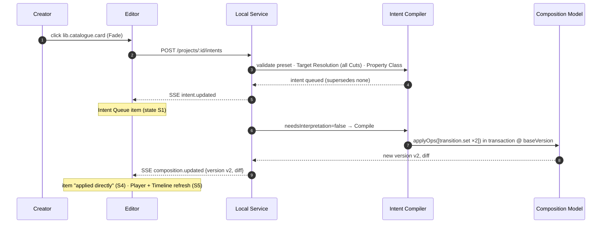
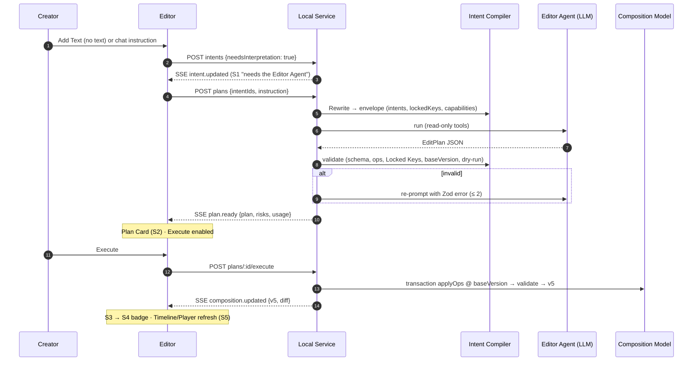

# User Flows

| Field | Value |
|---|---|
| Status | baseline |
| Owner | UI/UX lead |
| Last updated | 2026-10-25 |
| Depends on | GLOSSARY.md, ELEMENT_IDS.md, UXRD.md, PRD.md, AI_WORKFLOW.md, ARCHITECTURE.md (§5, §6), PERFORMANCE.md, DECISIONS.md (ADR-002, 008, 011, 014) |
| Used by | EDITOR_INTERACTION_MODEL.md, UI_UX_SPECIFICATION.md, ONBOARDING_TOUR.md, FRD.md, GOLDEN_SCENARIOS.md, TEST_PLAN.md |
| Owner of | flow numbering F1 … F15 and their step numbering |
| ID range | F1 … F15 (steps `F<n>.<step>`; failure branches `F<n>.E<k>`) |

## 0. Conventions

- Element ids are from ELEMENT_IDS.md and written as `el:…` only in prose; in tables the bare id is used.
- **SSE events** named here are those owned by API_SPECIFICATION.md (events table): `intent.updated`, `plan.ready`, `plan.invalid`, `composition.updated`, `render.*`, `ingest.progress` / `ingest.done` / `ingest.failed`, `agent.run.started` / `.delta` / `.done` / `.failed`, `model.progress` / `model.installed` / `model.failed`, `hardware.tick`, `license.changed`, `settings.changed`, `service.notice {kind}`. No other event names are used.
- **Error codes** are given by range and meaning (`EM-1xxx` assets, `EM-2xxx` composition/intents, `EM-3xxx` render, `EM-4xxx` providers, `EM-5xxx` licence, `EM-6xxx` storage, `EM-7xxx` models, `EM-8xxx` shell/network). Codes already fixed in other baseline documents (EM-2201, EM-3001, EM-3101…3104, EM-1301, EM-4101, EM-4102, EM-4201, EM-4301, EM-5001) are used as written there. ERROR_CATALOGUE.md owns exact codes and copy.
- Copy is given EN / ID. Priorities: P0 unless marked P1/P2 (PRD.md §4).
- Each flow has: preconditions, numbered steps (Creator action → system response → what the Creator sees), failure branches, exit state, and the UX requirements it verifies.

### Flow map

```
F1 first run ──► F13 licence ──► F10 Private Mode
     │
     ▼
F2 import/order/Insert ──► F3 pick → Compile ──► F7 preview/inspect ──► F8 export
     │                          │                          ▲
     │                          ├──► F4 pick → Editor Agent → Execute
     │                          │
     └──► F6 Home text ◄── F5 Brainstorm → handoff ───────┘
F9 crash/recovery, F11 Model Manager (P1), F12 Voice/Captions (P1), F14 Backup/Restore, F15 update: cross-cutting
```

---

## F1 First run: install → launch → licence activation → onboarding → provider → models → hardware check → tour → empty project

Preconditions: clean Windows 10/11, installer downloaded, no app data folder. Verifies UX-001, UX-025, PRD-001, PRD-018.

| Step | Creator action | System response | Creator sees | Events |
|---|---|---|---|---|
| F1.1 | Runs the signed installer | Installs to `%LOCALAPPDATA%\Expertmotion\app`; creates Start Menu/desktop shortcuts | Installer progress; "Launch Expertmotion" checkbox | — |
| F1.2 | Launches `Expertmotion.exe` | Desktop Shell acquires single-instance lock, creates Database Key via `safeStorage`, spawns Local Service (ARCHITECTURE.md §5.1–5.3) | Splash window with wordmark and "Starting…" / "Memulai…" (≤ 5 s target) | — (the Service reports `ready` on stdout to the Shell; the SSE stream opens afterwards) |
| F1.3 | — | Local Service detects Hardware Tier, opens empty DB, reports ready; no Licence Key is stored, so every `/api/v1` route except the licence screen's answers EM-5010 (no Trial Mode) | The licence screen alone (`scr.license`, `data-gate`): "Activate Expertmotion" / "Aktifkan Expertmotion", three steps, this computer's Machine Code with Copy, key field, Activate, "Get a licence key" and help links, language switch | — |
| F1.4 | Copies the Machine Code and sends it (purchase / support); receives the key bound to it (§12 email of LICENSE_OPERATIONS.md) | — | "Copied" / "Tersalin" on `scr.license.machinecode.copy` | — |
| F1.5 | Pastes the key (or drops the `.emlicense` file) and clicks Activate | Licence module verifies offline (Ed25519, Machine Fingerprint, revocation, build date); stores state; the gate opens | Toast "Licence activated" / "Lisensi diaktifkan"; the Editor continues without restart to `scr.onboarding.welcome` (step 1 of 5); "Skip setup" leads to F1.11 without a provider | `license.changed` |
| F1.6 | Step 2 (`scr.onboarding.provider`): selects provider (OpenRouter default), pastes key, clicks Validate | Local Service validates the key over HTTPS (not in Private Mode), stores encrypted, fetches model list | Spinner "Checking key…" / "Memeriksa kunci…" then green check and model count; **or** "Skip for now" (agents unavailable until configured) | — |
| F1.7 | Step 3 (`scr.onboarding.models`): accepts suggested Model Assignment for Brainstorming Agent and Editor Agent, optionally sets budget limit; clicks Test | Runs a 1-token test per assignment; records usage | Two rows with model name, context length, tool-calling badge, approximate price "≈ $/M tokens" or "n/a"; "Test passed" / "Tes berhasil" | — |
| F1.8 | Step 4 hardware check (`scr.onboarding.hardware`) | Shows tier, RAM, disk, GPU; sets Performance Profile default and resolution gating | "Your PC: Tier T0 · 16 GB RAM · no GPU acceleration. Standard profile, up to 1080p." / "PC kamu: Tier T0 · RAM 16 GB · tanpa akselerasi GPU. Profil Standard, hingga 1080p." Warning if RAM < 8 GB. | — |
| F1.9 | Step 5 (`scr.onboarding.tour`): "Start tour" or "Skip tour" | Creates project "Untitled" (default settings: 30 fps, Auto ratio, 1080p) | Editor with empty project; tour overlay if chosen (ONBOARDING_TOUR.md) | — |
| F1.10 | Completes or skips the tour | Marks onboarding done in settings.json | `scr.onboarding.done` success moment, then Editor | — |
| F1.11 | — | Empty project state | `lib.assets.empty`, `stage.timeline.empty`, `hdr.action.export.disabled` | — |

Failure branches:

| Branch | Condition | System response | Creator sees | Recovery |
|---|---|---|---|---|
| F1.E1 | Local Service fails to start 3× (ARCHITECTURE.md §5.6) | Shell shows native error dialog with diagnostics path | "Expertmotion could not start its local service · EM-8xxx. Copy diagnostics and contact support." / "Expertmotion tidak dapat memulai layanan lokalnya · EM-8xxx. Salin diagnostik dan hubungi dukungan." | Copy diagnostics; Retry |
| F1.E2 | Licence Key invalid / tampered / bound to another machine / revoked / too many attempts | `scr.license.error`; the licence screen stays the only screen | The catalogue copy of EM-5002 / EM-5003 (with the re-bind steps) / EM-5004 / EM-5005 / EM-5006 / EM-5009 / EM-5011 ("Wait {seconds} seconds") | Fix the key, contact support, or wait (F13) |
| F1.E3 | Provider key rejected | Inline `EM-4xxx` under `scr.providers.key.input` | "The provider rejected this key. Check it and try again." / "Penyedia menolak kunci ini. Periksa dan coba lagi." | Edit key; Skip |
| F1.E4 | No internet during F1.6 | Validation times out (30 s) | "No connection. You can skip and connect later from the Model Bar." / "Tidak ada koneksi. Kamu bisa lewati dan hubungkan nanti dari Model Bar." | Skip |
| F1.E5 | RAM < 8 GB | Warning in F1.8, not a block | "Below the minimum 8 GB. Expect slow previews; exports above 720p may fail." / "Di bawah minimum 8 GB. Pratinjau akan lambat; ekspor di atas 720p mungkin gagal." | Continue |

Exit state: Editor open, empty project, onboarding flag set. Re-runnable via Help ▸ Tour (`hdr.menu.help.tour`) and Model Bar → Providers.

---

## F2 Import → order → Insert

Preconditions: project open. Verifies UX-002, PRD-005, PRD-006.

| Step | Creator action | System response | Creator sees | Events |
|---|---|---|---|---|
| F2.1 | Drags three files from Explorer onto `lib.assets.drop` (or File ▸ Import / click panel) | Shell passes paths; Local Service copies into `media/<projectId>/<assetId>/`, starts probe → transcode (if needed) → proxy → thumbnail → waveform; ingest parallelism 2 | Three `lib.assets.card` in `.state.ingesting` with per-card progress and the step name ("Probing…", "Making proxy…" / "Memeriksa…", "Membuat proxy…") | `ingest.progress` per stage |
| F2.2 | Waits (≤ 20 s per 1-min 1080p clip) | Cards complete; metadata available in `lib.assets.card.meta` | Thumbnail, name, duration, badge for kind; tooltip with resolution/fps/audio/size | `ingest.done` |
| F2.3 | Clicks `lib.assets.card.badge.sequence` on each card to set 2, 3, 1 (click cycles; drag reorders) | Stores Sequence Badge per asset (not yet in Composition Model) | Numbered badges; Insert button shows "Insert 3" / "Sisipkan 3" | — |
| F2.4 | Ticks `lib.assets.card.select` (auto-ticked when a badge is set) | Enables `lib.assets.insert` | Button enabled | — |
| F2.5 | Clicks `lib.assets.insert` | Creates Edit Intents (`category: asset`, `source: ui`, `needsInterpretation: false`) → Compile → `op:clip.insert` × 3 in badge order → new Composition Version; if Auto ratio is on, sets ratio from the first Clip's probe | Intent Queue shows "Insert 3 clips · applied directly" / "Sisipkan 3 klip · langsung diterapkan"; Timeline View gets three Clips on `stage.timeline.track.video` with Cuts; Player shows frame 0; `hdr.action.export` enabled; `hdr.title.dirty` | `intent.updated`, `composition.updated` |
| F2.6 | — | Sequence Badges clear; cards show "In timeline" chip | Toast "Inserted 3 clips · v1" / "3 klip disisipkan · v1" with Undo | — |

Failure branches:

| Branch | Condition | Response | Creator sees | Recovery |
|---|---|---|---|---|
| F2.E1 | Unsupported extension or codec | Card enters `.state.unsupported`, `lib.assets.error` banner | "Cannot use holiday.avi · EM-1xxx. Supported: MP4, MOV, WebM, MKV, PNG, JPG, WebP, GIF, MP3, WAV, AAC, M4A, OGG." / "Tidak bisa memakai holiday.avi · EM-1xxx. Didukung: …" | Remove card; import another file |
| F2.E2 | Transcode fails (HEVC without decoder, corrupt file) | Card error with reason | "Could not prepare clip.mov · EM-1xxx. The file may be damaged." / "Tidak dapat menyiapkan clip.mov · EM-1xxx. Berkas mungkin rusak." | Retry; Remove |
| F2.E3 | Disk full during copy | `EM-6xxx` | "Not enough disk space to import (need 1.2 GB)." / "Ruang disk tidak cukup untuk impor (perlu 1,2 GB)." | Free space; retry |
| F2.E4 | Insert while an asset is still ingesting | Insert disabled for that asset, others proceed; tooltip | "Still preparing beach.mp4" / "Masih menyiapkan beach.mp4" | Wait |
| F2.E5 | Duplicate file (same hash) | Dedupe, reuse asset | Toast "Already imported as beach.mp4" / "Sudah diimpor sebagai beach.mp4" | — |

Exit: Composition Version with ≥ 1 Clip; Export enabled.

---

## F3 Design Pick → Intent Queue → Compile (deterministic) → version

Preconditions: F2 done (≥ 2 Clips), Design mode. Verifies UX-004, UX-010, UX-013, AI-003, AI-011. Golden scenario family: transitions on all cuts.

| Step | Creator action | System response | Creator sees | Events |
|---|---|---|---|---|
| F3.1 | Clicks `hdr.menu.design` | Library Panel → Design mode | `lib.mode.header` "Preview"; `lib.catalogue.tab` Transitions active | — |
| F3.2 | Hovers `lib.catalogue.card` (Fade) | Editor requests live preview of `preset:transition.fade` on the current Composition Version at the first Cut (ADR-011; no intent created) | Player plays a 2 s loop around Cut 1 with Fade; card raised | — |
| F3.3 | Clicks the card | POST intent `{category: transition, presetId: preset:transition.fade, target: selection}`; Target Resolution → nothing selected → **all Cuts**; Property Class exclusive-group; `needsInterpretation: false` → Compile → one parent intent plus 2 child intents with `parentIntentId` (`cut:0.transition`, `cut:1.transition`; AI_WORKFLOW.md §6 expansion rule) → `op:transition.set` × 2 → transaction → new version | `lib.catalogue.card.selected`; Intent Queue item "Transition · Fade → all 2 cuts · applied directly" / "Transisi · Pudar → semua 2 potongan · langsung diterapkan"; `stage.timeline.element.transition` × 2 appear; Player refreshes; toast with Undo | `intent.updated`, `composition.updated` |
| F3.4 | Clicks another transition (Slide) | New intent with same `propertyKey` set → the Fade intents are `superseded`; Compile → `op:transition.set` Slide | Intent Queue: "Slide → all 2 cuts" on top; Fade struck through with Restore; version v3 | `intent.updated`, `composition.updated` |
| F3.5 | Selects Clip 2 in the Timeline View, then clicks Wipe | Target Resolution → the Cut after the selected Clip only (`cut:1` in data); only that child of the Slide pick is superseded | Item "Transition · Wipe → cut 2"; the Slide parent reads "Slide → cut 1 · cut 2 replaced by Wipe" (partial supersession) | `intent.updated`, `composition.updated` |
| F3.6 | Switches tab to Captions, clicks Karaoke | Project-scoped exclusive-group; Compile → `op:caption.setStyle`; if no caption data yet, the Timeline View shows the caption Track with an empty-state hint | Item "Caption style · Karaoke → project"; hint "No captions yet. Import an SRT (File ▸ Import) or generate captions (Tools, P1)." / "Belum ada caption. Impor SRT (File ▸ Import) atau buat caption (Tools, P1)." | as above |

Sequence (deterministic path):



Failure branches:

| Branch | Condition | Response | Creator sees | Recovery |
|---|---|---|---|---|
| F3.E1 | Pick on a GPU-flagged preset at T0 (e.g. `preset:effect.glow`) | Allowed with warning badge; validator enforces max 2 effects on T0 | Badge "Slower without GPU" / "Lebih lambat tanpa GPU"; third effect rejected with `EM-2xxx` "Up to 2 effects per element on this PC" / "Maksimal 2 efek per elemen di PC ini" | Remove one effect |
| F3.E2 | Motion/effect pick with nothing selected and no Clip under the playhead | Reject `EM-2201` | Inline under the Intent Queue: "Select a clip or move the playhead onto one" / "Pilih klip atau geser playhead ke salah satu klip" | Select and re-pick |
| F3.E3 | Transition longer than 50 % of shorter Clip | Validator clamps + `warn`; `< 100 ms` → `block` | Item note "Shortened to 400 ms to fit clip 2" / "Dipersingkat ke 400 ms agar muat di klip 2" | Accept or trim (P1) |
| F3.E4 | Preset needs a model not installed (`lib.catalogue.card.badge.model`) | Pick blocked; opens Model Manager prompt | "Needs <model> (1.2 GB). Install?" / "Perlu <model> (1,2 GB). Pasang?" | F11 |
| F3.E5 | Private Mode on and preset is deterministic | Works normally (no network) | — | — |

Exit: new Composition Version; no provider call made; no model name shown.

---

## F4 Design Pick needing interpretation → Editor Agent → Plan Card → Execute

Preconditions: provider configured, Private Mode off, ≥ 1 Clip. Verifies UX-003, UX-012, UX-016, AI-012, AI-013, AI-014.

| Step | Creator action | System response | Creator sees | Events |
|---|---|---|---|---|
| F4.1 | In Home mode clicks `lib.text.variant` Title, then `lib.text.add` **without typing text**; or types in `agent.editor.composer` "buat judul pembuka yang kuat, nuansa energik" and clicks `agent.editor.send` | Intent `{category: text, presetId: preset:text.title, needsInterpretation: true, instruction: "…"}`; Rewrite builds the envelope (AI_WORKFLOW.md §7) including Locked Keys (e.g. `cut:1.transition`) | Intent Queue item "Title · needs the Editor Agent" / "Judul · perlu Editor Agent" (state S1); Editor Chat shows the Creator's message; status line "Asking Claude 3.5 Sonnet…" / "Bertanya ke Claude 3.5 Sonnet…" with Cancel | `intent.updated`, `agent.run.started`, `agent.run.delta` |
| F4.2 | Waits (≤ 30 s first token) | Editor Agent calls read-only Tools (`composition.get`, `catalogue.search`), returns `EditPlan` JSON; validator: schema, op vocabulary, Locked Keys, `baseVersion`, dry-run | `agent.editor.plancard` (state S2): goal, 2–4 steps each with `.step.tool` and `.step.diff` ("Add Title 'Liburan Seru!' 0.0–3.0 s, Rise motion, Highlight effect"), `.risk` list, `.baseversion` "based on v4", usage line "1 240 in · 310 out · ≈ $0.004"; `agent.editor.execute` enabled | `plan.ready` |
| F4.3 | Optionally types in `agent.editor.plancard.notes` ("lebih pendek") and clicks Re-plan (or sends another message) | New agent run with `creatorNotes`; previous plan marked `cancelled` and collapsed | New Plan Card replaces the old; old is available under "Previous plans" | `plan.ready` |
| F4.4 | Presses `agent.editor.execute` (or Ctrl+Enter) | POST execute; plan `executing` (S3); `composition.applyOps` in one transaction at `baseVersion`; post-validation; new version | Card badge "Executing…"; then "Applied · version 5" (S4); Timeline View adds `stage.timeline.element.text`; Player jumps to the new element's start and shows it (S5); toast with Undo | `composition.updated` |
| F4.5 | — | Intent Queue items referenced by the plan move to `executed`; usage recorded | Items collapse under "Applied in v5" | `intent.updated` |

Sequence (interpretation path):



Failure branches:

| Branch | Condition | Response | Creator sees | Recovery |
|---|---|---|---|---|
| F4.E1 | Provider timeout | retry once; `EM-4101` | Chat system bubble "The model did not answer in time · EM-4101" / "Model tidak menjawab tepat waktu · EM-4101" with Try again / Switch model; message kept in composer | UX-033 |
| F4.E2 | Rate limit | wait `Retry-After` ≤ 20 s once; `EM-4102` | "Provider is busy. Waiting 12 s…" / "Penyedia sibuk. Menunggu 12 d…" then error | Try again |
| F4.E3 | Invalid plan JSON after 2 re-prompts | `EM-4301`; raw text collapsed | "The Editor Agent's answer could not be used · EM-4301. Show raw answer" / "Jawaban Editor Agent tidak dapat dipakai · EM-4301. Tampilkan jawaban mentah" | Rephrase; switch model |
| F4.E4 | Plan touches Locked Keys after re-prompt | ops dropped; notice on the card | Risk row "Skipped 1 step that would change your transition on cut 1 (you picked it)" / "Melewati 1 langkah yang akan mengubah transisi di potongan 1 (pilihan kamu)" | Execute remaining; or restore the intent |
| F4.E5 | Composition changed before Execute (another Compile happened) | plan `stale`; Execute disabled | `agent.editor.plancard.baseversion.stale` "Composition changed; re-plan" / "Komposisi berubah; susun ulang" with Re-plan button | Re-plan |
| F4.E6 | Execute fails mid-transaction | rollback; version unchanged | Badge "Not applied · EM-2xxx" with Details; Player unchanged | Re-plan; Try again |
| F4.E7 | Budget exceeded | `EM-4201`; run not started | "Monthly AI budget reached ($5.00). Raise the limit in Providers." / "Anggaran AI bulanan tercapai ($5,00). Naikkan batas di Providers." | Open Providers |
| F4.E8 | Model lacks tool calling | JSON-mode fallback, silent to the Creator except a footer badge "JSON mode" | — | — |
| F4.E9 | Service restart during run | run `cancelled` | Card "Interrupted · re-run" / "Terputus · jalankan ulang" | One-click re-run |

Exit: new version with the Text Layer; usage recorded; plan `executed`.

---

## F5 Brainstorm → handoff → Editor Agent

Preconditions: as F4. Verifies AI-019, UX-003.

| Step | Creator action | System response | Creator sees | Events |
|---|---|---|---|---|
| F5.1 | Types in `agent.brainstorm.composer` "video promo kafe 30 detik, santai tapi modern" and sends | Brainstorming Agent run (read-only tools: `composition.get` summary, `assets.list`, `catalogue.search`, `hardware.profile`) | "Asking <model>…"; then assistant bubble in Indonesian with 2–3 concept options and a clarifying question | `agent.run.started`, `agent.run.delta`, `agent.run.done` |
| F5.2 | Answers the question ("pilih opsi 2, pakai musik pelan") | Agent replies with a concrete proposal and `proposedIntents` (e.g. caption Editorial, background Spotlight, audio bed soft, title text) | `agent.brainstorm.handoff` card: list of proposed intents with preset labels and targets; buttons "Send to Editor Agent" / "Kirim ke Editor Agent" and "Dismiss" / "Abaikan"; items the Creator can untick | — |
| F5.3 | Unticks one item, clicks Send to Editor Agent | Intents enter the Intent Queue with `source: brainstorm`; fully specified ones (`needsInterpretation: false`) Compile immediately; the rest trigger one Editor Agent run (F4.2 onward) | Intent Queue: 2 items "applied directly", 1 item "needs the Editor Agent"; Editor Chat shows a system bubble "From Brainstorming: 3 requests" / "Dari Brainstorming: 3 permintaan"; Plan Card appears | `intent.updated`, `composition.updated`, `plan.ready` |
| F5.4 | Executes (F4.4) | — | — | `composition.updated` |

Failure branches: F4.E1–E3, E7–E9 apply to the Brainstorming Agent with the same copy. Additional:

| Branch | Condition | Response | Creator sees | Recovery |
|---|---|---|---|---|
| F5.E1 | Brainstorming Agent proposes a preset id not in the catalogue | Dropped at validation with notice | Handoff card row greyed "Not available in this version" / "Tidak tersedia di versi ini" | Send the rest |
| F5.E2 | Image attachment to a model without image input | Blocked before send | "This model cannot see images. Describe it instead, or switch model." / "Model ini tidak bisa melihat gambar. Jelaskan dengan kata-kata, atau ganti model." | — |

Exit: Intent Queue populated; Composition Version(s) created only via Compile or Execute. The Brainstorming Agent never mutated state.

---

## F6 Home text controls → Add Text

Preconditions: ≥ 1 Clip. Verifies AI-003 (font size is deterministic), Target Resolution text row.

| Step | Creator action | System response | Creator sees | Events |
|---|---|---|---|---|
| F6.1 | Clicks `hdr.menu.home` | Library Panel → Home mode | `lib.mode.header` "Text"; Text Panel controls | — |
| F6.2 | Picks `lib.text.font` Plus Jakarta Sans, `lib.text.size` 96, `lib.text.colour` accent, `lib.text.align` centre, with **no Text Layer selected** | Each pick → scalar intent, target → Theme default for new text (Target Resolution); Compile → `op:theme.setTextDefaults` (propertyKey `theme.textDefaults.<field>`); version per pick (coalesced if < 2 s apart into one version with several ops) | Intent Queue items "Font size 96 · applies to new text" / "Ukuran font 96 · berlaku untuk teks baru"; Player unchanged (no text yet) | `intent.updated`, `composition.updated` |
| F6.3 | Types "Diskon 50%" into the Add Text field and clicks `lib.text.add` | Intent `{category: text, presetId: preset:text.title (current variant), params: {text}, target: playhead, needsInterpretation: false}` → Compile → `op:text.add` at playhead, default 3 000 ms | Text Layer appears on `stage.timeline.track.text` at the playhead and is selected; Player shows it; inspector opens | `composition.updated` |
| F6.4 | With the Text Layer selected, picks size 72 | Target → selected Text Layer; `op:text.setStyle {fontSize}`; scalar supersedes within the same key | Item "Font size 72 (replaced 96) → Title 'Diskon 50%'"; Player updates | as above |
| F6.5 | Picks `lib.text.effect` Highlight | exclusive-group per Text Layer → `op:text.setEffect` | Highlight animates under the text in the Player | as above |

Failure branches:

| Branch | Condition | Response | Creator sees | Recovery |
|---|---|---|---|---|
| F6.E1 | Add Text with empty field | Routed to F4 (needs interpretation: the Editor Agent proposes text) if a provider is configured; otherwise disabled with hint | "Type the text, or let the Editor Agent suggest one" / "Ketik teksnya, atau biarkan Editor Agent mengusulkan" | — |
| F6.E2 | Text does not fit the safe area at the chosen size | `fitText` shrinks; validator `warn` | Item note "Shrunk to 84 to fit the frame" / "Diperkecil ke 84 agar muat di bingkai" | — |
| F6.E3 | Playhead outside any Clip | Text still added (text Track is independent), `warn` if beyond total duration (trimmed) | Note "Shortened to end of video" / "Dipersingkat sampai akhir video" | — |

---

## F7 Preview and inspect the Timeline View

Preconditions: any Composition Version. Verifies PRD-007, PRD-009, UX-052.

| Step | Creator action | System response | Creator sees |
|---|---|---|---|
| F7.1 | Presses Space or `stage.player.controls.play` | Player plays in Draft quality (proxy, Standard/Accelerated) or Full (Turbo) | Playhead moves on `stage.timeline.head`; `stage.player.controls.time` updates (mm:ss.ff) |
| F7.2 | Drags `stage.player.controls.scrubber` or clicks `stage.timeline.ruler` | Seek (≤ 100 ms) | Frame updates; time updates |
| F7.3 | Presses ← / → (frame) or Shift+← / → (1 s) | Frame-step | — |
| F7.4 | Clicks `stage.timeline.element.clip` (Clip 2) | Selection = Clip 2; `stage.timeline.inspector` opens read-only: asset, trim, duration, playback rate, volume, fit, motion, effects, transitions on adjacent Cuts | Element outlined; inspector sheet; Design Picks now target this Clip (F3.5) |
| F7.5 | Clicks "Ask Editor Agent to change" in the inspector | Prefills `agent.editor.composer` with "Change clip 2 (beach.mp4): " and focuses it; attaches `target: clip:<id>` to the next message | Composer focused with prefix chip "clip 2" |
| F7.6 | Opens `stage.player.menu` → Safe area overlay | Overlay drawn for the current ratio | Guides visible |
| F7.7 | Toggles `stage.player.controls.fullscreen` | Player fills the window; Esc exits | — |

Failure branches:

| Branch | Condition | Response | Creator sees | Recovery |
|---|---|---|---|---|
| F7.E1 | Proxy missing / media error | `stage.player.state.error` | "Preview could not load clip 2 · EM-1xxx. Rebuild preview?" / "Pratinjau tidak dapat memuat klip 2 · EM-1xxx. Bangun ulang pratinjau?" | Rebuild proxy |
| F7.E2 | Bundle still loading (cold start) | `stage.player.state.loading` | "Loading preview…" / "Memuat pratinjau…" (skeleton) | wait |
| F7.E3 | Composition invalid after a restore | Player shows last valid version; banner | "Showing version v6; v7 has a problem · EM-2xxx" / "Menampilkan versi v6; v7 bermasalah · EM-2xxx" | Undo / Recover |

---

## F8 Output Settings and Export: preflight → progress → cancel → open folder

Preconditions: Composition Version with ≥ 1 Clip. Verifies PRD-008, PRD-014, UX-023, UX-025, UX-026, UX-031.

| Step | Creator action | System response | Creator sees | Events |
|---|---|---|---|---|
| F8.1 | In `agent.output`, clicks `agent.output.ratio.9x16` | Intent `{category: layout}` → Compile → `op:output.setRatio` → version; Player frame resizes; pixel labels update | Button active with orientation glyph and "9:16 · 1080×1920"; `stage.player.controls.ratio` "9:16" | `composition.updated` |
| F8.2 | Clicks `agent.output.resolution.1080p` | `op:output.setResolution` | Labels update on all ratio buttons | `composition.updated` |
| F8.3 | Hovers `agent.output.profile.help`; leaves Standard | Tooltip (PERFORMANCE.md §2 copy) | Tooltip | — |
| F8.4 | Clicks `hdr.action.export` (or File ▸ Export, Ctrl+E) | Opens `scr.export`; runs preflight (PERFORMANCE.md §7) and `render.estimate` | `.profile.summary` "9:16 · 1080×1920 · 30 fps · 0:42 · Standard"; `.codec` H.264 MP4 (GIF/PNG still options); `.filename`; `.folder`; `.preflight` rows each with ✓ or ⚠: disk, memory, dimensions, duration, assets, engine, licence; estimate "≈ 1 min 30 s · ≈ 35 MB" | — |
| F8.5 | Clicks `scr.export.start` | POST /renders; job `queued` → `rendering`; one job at a time | `.progress` bar + percent; `.eta` "Estimating…" then "≈ 1 min left"; `sys.render.progress` chip in the header so the Creator can close the dialog and keep editing; Export button shows the chip | `render.progress` |
| F8.6a | Waits | Output validated (ffprobe duration/dimensions/fps) | `.done`: thumbnail, filename, size, duration; `.open.folder`; "Export again"; success moment (ONBOARDING_TOUR.md §5 on first export) | `render.done` |
| F8.6b | Clicks `.cancel` during render | Chrome killed; partial file removed; job `cancelled` | "Export cancelled. No file was saved." / "Ekspor dibatalkan. Tidak ada berkas tersimpan." | — |
| F8.7 | Clicks `.open.folder` | Shell opens Explorer at the output folder | — | — |

Failure branches:

| Branch | Condition | Response | Creator sees | Recovery |
|---|---|---|---|---|
| F8.E1 | Preflight disk fail | `EM-3102`; Start disabled | Row ⚠ "Need 1.6 GB free, have 0.9 GB" / "Perlu 1,6 GB kosong, tersedia 0,9 GB" | Change folder; free space |
| F8.E2 | Preflight memory fail | `EM-3101` | "Close other apps: need 2 GB free RAM" / "Tutup aplikasi lain: perlu RAM kosong 2 GB" | Retry preflight |
| F8.E3 | Engine binaries missing | `EM-3001` | "Rendering engine is missing · EM-3001. Repair the installation." / "Mesin render tidak ditemukan · EM-3001. Perbaiki pemasangan." | Repair (reinstall) |
| F8.E4 | (Removed 2026-10-25: Trial Mode no longer exists; exports are never watermarked or capped by the licence) | — | — | — |
| F8.E5 | 2160p on T0 | Button `.disabled` with reason; not reachable | "Needs a GPU tier" / "Perlu GPU" | — |
| F8.E6 | Render process crash | job `failed`, partial removed | Toast "Export failed · EM-3xxx" with Try again / Details | Retry; lower Resolution or profile |
| F8.E7 | Output validation mismatch | job `failed` | "The file did not pass checks (duration mismatch) · EM-3xxx" / "Berkas tidak lolos pemeriksaan (durasi tidak cocok) · EM-3xxx" | Retry |
| F8.E8 | Window close during render | Shell prompts (ARCHITECTURE.md §5.5) | "An export is running. Cancel it and quit?" / "Ekspor sedang berjalan. Batalkan dan keluar?" | Keep rendering / Quit |

Exit: Output listed; file on disk; job `done`.

---

## F9 Crash and recovery

Preconditions: project with unsaved changes; checkpoints every ≤ 10 s (PRD-003). Verifies UX-030, UX-032, UX-034.

| Step | Trigger / action | System response | Creator sees | Events |
|---|---|---|---|---|
| F9.1 | Local Service crashes (or is killed) | Shell restarts it with backoff 1 s / 3 s / 9 s; Service marks interrupted renders `failed` and agent runs `cancelled` | `sys.offline` banner "Reconnecting… 1/3" / "Menyambung ulang… 1/3"; all other toasts suppressed; controls that need the service disabled | — |
| F9.2 | Service back | Editor reconnects SSE; re-fetches project head | Banner "Reconnected" / "Tersambung kembali" (2 s); if a Plan Card was executing: "Interrupted · re-run"; if a render was running: toast "Export interrupted · EM-3xxx" with Try again | `service.notice {kind:'resync'}` (EM-8003) |
| F9.3 | Whole app killed (Task Manager, power loss) → Creator relaunches | Service compares last checkpoint vs last save | `scr.project.recover` opens: "We found unsaved work from 14:32 (version v9, 3 changes after your last save)." / "Ada pekerjaan belum tersimpan dari 14:32 (versi v9, 3 perubahan setelah simpanan terakhir)." Buttons: Restore / Open last saved / Show both | — |
| F9.4 | Clicks Restore | Checkpoint becomes head; project opens; `hdr.title.dirty` set | Editor with recovered state; toast "Recovered v9" / "v9 dipulihkan" | `composition.updated` |
| F9.5 | Later, File ▸ Recover (`hdr.menu.file.recover`) | Lists last 20 checkpoints with time and version | Table; "Restore this" per row (creates a new version, never deletes) | — |

Failure branches:

| Branch | Condition | Response | Creator sees | Recovery |
|---|---|---|---|---|
| F9.E1 | Service fails 3 restarts | Shell dialog | "Expertmotion's local service keeps stopping · EM-8xxx. Your work is saved up to 14:32. Copy diagnostics?" / "Layanan lokal Expertmotion terus berhenti · EM-8xxx. Pekerjaan kamu tersimpan sampai 14:32. Salin diagnostik?" | Diagnostics; Restart app |
| F9.E2 | Checkpoint corrupt | Skip to previous | "Checkpoint 14:32 is damaged; offering 14:31" / "Checkpoint 14:32 rusak; menawarkan 14:31" | — |
| F9.E3 | DB cannot be opened (key missing after Windows profile change) | `EM-6xxx` | "Project data cannot be unlocked on this Windows account · EM-6xxx. Restore from a backup (zip)." / "Data proyek tidak dapat dibuka di akun Windows ini · EM-6xxx. Pulihkan dari cadangan (zip)." | F14 |

---

## F10 Private Mode toggle

Verifies UX-024, PRD-020, AI-017.

| Step | Creator action | System response | Creator sees | Events |
|---|---|---|---|---|
| F10.1 | Toggles `agent.output.private` on | Settings persisted; egress module blocks providers, model downloads, update checks; in-flight agent runs cancelled; downloads paused | `sys.privatemode.banner` on every screen; `agent.modelbar.status` private icon; both composers disabled with the inline note (UX-024); Model Manager install buttons disabled "Paused in Private Mode" / "Dijeda di Mode Privat"; `sys.update` hidden | `settings.changed {scope:'privateMode'}` |
| F10.2 | Keeps working: picks, Insert, preview, Export | All deterministic paths work | Normal | normal events |
| F10.3 | Toggles off | Egress re-enabled; paused downloads resume; update check runs at next scheduled time | Banner removed; composers enabled; toast "Private Mode off. Agents available." / "Mode Privat nonaktif. Agen tersedia." | — |

Failure branches:

| Branch | Condition | Response | Creator sees |
|---|---|---|---|
| F10.E1 | Toggle on during an Editor Agent run | Run cancelled (not force-applied) | Plan Card "Cancelled · Private Mode" / "Dibatalkan · Mode Privat" |
| F10.E2 | Toggle on during a model download | Download paused, resumable | Row "Paused · 42 %" |

Note (ADR-017): if Remotion v5 render telemetry cannot be disabled, Private Mode shows an additional line in the Export preflight stating exactly what is sent; this is an open question and the copy is not final.

---

## F11 Model Manager download (P1)

Preconditions: Private Mode off, feature needing a Local Model (e.g. Generate Captions). Verifies ADR-008.

| Step | Creator action | System response | Creator sees | Events |
|---|---|---|---|---|
| F11.1 | Clicks `hdr.action.models` (or a `badge.model` on a card) | Opens `scr.models` | `.list` of models grouped by engine; each `.row`: name, task, size, licence, Hardware Tier requirement (`.tier`), state (Not installed / Installed / Downloading) | — |
| F11.2 | Clicks `.row.install` on "whisper large-v3-turbo (1.6 GB)" | Model Download starts: hash-verified, resumable | `.row.progress` "312 MB / 1.6 GB · 2.1 MB/s · ≈ 10 min" | `model.progress` |
| F11.3 | Closes the screen | Download continues in the background (paused during a Standard/Accelerated render per PERFORMANCE.md §2) | `sys.toast` on completion "whisper large-v3-turbo installed" / "whisper large-v3-turbo terpasang" | `model.installed` |
| F11.4 | Clicks `.row.remove` on an installed model | Confirmation naming size freed | "Remove whisper large-v3-turbo (1.6 GB)? Features that need it will ask again." / "Hapus whisper large-v3-turbo (1,6 GB)? Fitur yang memerlukannya akan meminta lagi." | — |

Failure branches:

| Branch | Condition | Response | Creator sees |
|---|---|---|---|
| F11.E1 | Hash mismatch | file discarded; `EM-7xxx` | "Download was corrupted; retrying" / "Unduhan rusak; mencoba lagi" (auto once) |
| F11.E2 | Model needs T1 and PC is T0 | Install allowed only for CPU-capable models; others disabled | "Needs a GPU with 4 GB" / "Perlu GPU 4 GB" |
| F11.E3 | Disk insufficient | `EM-6xxx` | "Need 1.6 GB free" / "Perlu 1,6 GB kosong" |
| F11.E4 | Network lost mid-download | Paused, auto-resume | "Paused · waiting for connection" / "Dijeda · menunggu koneksi" |

---

## F12 Generate Voice (P1) and Generate Captions (P1)

Preconditions: model installed (F11), Tools mode. Verifies ADR-009, PRD-031, PRD-033.

Generate Captions:

| Step | Creator action | System response | Creator sees | Events |
|---|---|---|---|---|
| F12.1 | Clicks `hdr.menu.tools` → `lib.generator.card.captions` | Opens `scr.generate.captions` | Form: source (whole video / selected clip), `.language` id/en (default project language), `.model` (installed), caption style (current `preset:caption.*`), `.run` | — |
| F12.2 | Clicks `.run` | Intent `{category: generate}` → plan step `captions.generate` → whisper.cpp job → pages | `.progress` "Transcribing 0:42 of audio… 35 %" / "Mentranskripsi audio 0:42… 35 %"; Cancel | `service.notice {kind:'generator'}` |
| F12.3 | Reviews `.result` (editable text per page, timings) and clicks `.insert` | Plan Card with `op:caption.setPages` → Execute | Captions on `stage.timeline.track.caption`; Player shows them | `plan.ready`, `composition.updated` |

Generate Voice:

| Step | Creator action | System response | Creator sees |
|---|---|---|---|
| F12.4 | `lib.generator.card.voice` → types script, picks voice (id/en Piper voices), speed | `tts.generate` job (sherpa-onnx) | Progress; preview play button on the result |
| F12.5 | Clicks `.insert` | Plan: `op:generated.insert {kind: voice}` → audio layer at playhead; offers `preset:audio.duck-voice` for the bed | Audio Layer on `stage.timeline.track.audio`; Plan Card shows both steps; Execute |

Failure branches:

| Branch | Condition | Response | Creator sees |
|---|---|---|---|
| F12.E1 | Model not installed | Form shows install prompt | "Install whisper (1.6 GB) first" / "Pasang whisper (1,6 GB) dulu" → F11 |
| F12.E2 | No audio in source | `EM-7xxx` | "This video has no audio to transcribe" / "Video ini tidak punya audio untuk ditranskripsi" |
| F12.E3 | Engine Binary crash | job `failed` | "Caption generation stopped · EM-7xxx. Try the smaller model." / "Pembuatan caption berhenti · EM-7xxx. Coba model lebih kecil." |
| F12.E4 | Private Mode | Local generation still works (no network); only downloads blocked | — |

---

## F13 Licence activation and re-bind

Verifies PRD-017, ADR-014.

| Step | Creator action | System response | Creator sees | Events |
|---|---|---|---|---|
| F13.1 | Not licensed: launches Expertmotion (licence screen only). Licensed: `hdr.action.license` → "Manage licence" or Help ▸ Licence | Opens `scr.license` (whole window while locked, modal while licensed) | Machine Code with Copy, `.input`, `.activate`, "Get a licence key" and help links; while licensed the status card "Licensed to … · updates until …" and Deactivate | — |
| F13.2 | Pastes key, clicks `.activate` | Offline Ed25519 verification against the embedded public key; fingerprint match; revocation list check; rate limit (5 failures per minute) | "Licence activated" / "Lisensi diaktifkan"; onboarding or the Editor opens without restart | `license.changed` |
| F13.3 | On a new PC: pastes the same key | Fingerprint mismatch; re-bind allowed if count < limit | "This key is bound to another computer. Move it here? (1 of 2 moves left)" / "Kunci ini terikat ke komputer lain. Pindahkan ke sini? (1 dari 2 pemindahan tersisa)" → `scr.license.rebind` | — |
| F13.4 | Confirms re-bind | New binding recorded (per LICENSE_OPERATIONS.md) | Activated | — |

Failure branches:

| Branch | Condition | Response | Creator sees |
|---|---|---|---|
| F13.E1 | Signature invalid | `scr.license.error` `EM-5xxx` | "This key is not valid · EM-5xxx. Check for typos or contact support." / "Kunci tidak valid · EM-5xxx. Periksa salah ketik atau hubungi dukungan." |
| F13.E2 | Revoked | `EM-5xxx` | "This key has been revoked" / "Kunci ini telah dicabut" |
| F13.E3 | Re-bind limit reached | `EM-5xxx` | "No moves left. Contact support." / "Tidak ada pemindahan tersisa. Hubungi dukungan." |
| F13.E4 | Too many attempts | `EM-5011` (HTTP 429) | "Too many activation attempts. Wait {seconds} seconds, then try again." / "Terlalu banyak percobaan aktivasi. Tunggu {seconds} detik, lalu coba lagi." |
| F13.E5 | Clock moved back more than 24 h | `EM-5007` (info; licence unaffected) | Badge "Clock changed" / "Jam berubah" in the licence popover |
| F13.E5 | Update-eligibility date passed | Licensed, but `sys.update` says the update needs a renewed licence | "Update 1.4 is available but your updates ended on 2027-10-24." / "Pembaruan 1.4 tersedia tetapi masa pembaruan kamu berakhir 2027-10-24." |

---

## F14 Backup and Restore

Verifies ADR-006 consequences (DPAPI ties data to the Windows account).

| Step | Creator action | System response | Creator sees |
|---|---|---|---|
| F14.1 | Clicks `hdr.action.backup`, enters a passphrase in `scr.backup.backup.passphrase` (default; or ticks `scr.backup.backup.plain` and reads its warning), optionally includes Outputs, clicks `scr.backup.backup.start` | Save dialog (Shell); Service writes a zip: project JSON export (last 50 versions), intents, plans, media originals, outputs optional, **no provider credentials, no Database Key, no licence**; encrypted with an Argon2id-derived key from the passphrase (SECURITY.md SEC-052), or plain when the Creator chose so; manifest records which form | Plain choice shows the warning "Anyone with this file can read your clips, text and chats." / "Siapa pun yang punya berkas ini bisa membaca klip, teks, dan percakapan kamu."; `scr.backup.progress` "Backing up… 3 of 12 files" / "Mencadangkan… 3 dari 12 berkas"; then "Backup saved: promo-kafe-2026-10-24.zip (812 MB)" / "Cadangan tersimpan: …" |
| F14.2 | Clicks `hdr.action.restore`, picks the zip in `scr.backup.restore.file`, enters the passphrase in `scr.backup.restore.passphrase` when the manifest says the zip is encrypted | Validates manifest version and hashes (DATABASE_SCHEMA.md §6) | Preview: project name, versions, assets, size; note "Restored as a new project. Nothing is overwritten." / "Dipulihkan sebagai proyek baru. Tidak ada yang ditimpa."; `scr.backup.restore.start` |
| F14.3 | Clicks `scr.backup.restore.start` | Imports as a **new** project (never overwrites; a same-identity project becomes "<name> (restored)" with EM-6303), re-ingests missing derived files, creates versions; opens the project | `scr.backup.progress`; toast "Restored promo-kafe (v12)" / "promo-kafe dipulihkan (v12)" |

Failure branches:

| Branch | Condition | Response | Creator sees |
|---|---|---|---|
| F14.E1 | Zip from a newer app version | `EM-6302` | "This backup needs Expertmotion 1.5 or newer" / "Cadangan ini perlu Expertmotion 1.5 atau lebih baru" |
| F14.E2 | Missing media in zip (outputs excluded) | Restore continues; outputs listed as missing | "3 outputs were not in the backup" / "3 hasil ekspor tidak ada di cadangan" |
| F14.E3 | Disk insufficient | `EM-6xxx` | "Need 1.1 GB free" / "Perlu 1,1 GB kosong" |
| F14.E4 | Wrong or missing passphrase for an encrypted zip | `EM-6305`; nothing imported | "The passphrase does not open this backup." / "Frasa sandi tidak dapat membuka cadangan ini."; Try again |
| F14.E5 | Same project identity already exists | `EM-6303` (info); copy created | "Restored as \"promo-kafe (restored)\". Nothing was overwritten." / "Dipulihkan sebagai \"promo-kafe (restored)\". Tidak ada yang ditimpa." |

---

## F15 Update available

Preconditions: Private Mode off; signed update feed reachable.

| Step | Trigger / action | System response | Creator sees | Events |
|---|---|---|---|---|
| F15.1 | Shell checks the feed at launch and every 24 h (never during a render) | Finds 1.4.0 | `sys.update` chip "Update 1.4 available" / "Pembaruan 1.4 tersedia" (non-blocking) | `service.notice {kind:'update'}` (EM-8105) |
| F15.2 | Clicks chip | Shows release notes (EN/ID) and size | "Download (120 MB)" / "Unduh (120 MB)"; "Later" / "Nanti" | — |
| F15.3 | Clicks Download | Downloads and verifies the signature in the background | Chip "Downloading 45 %"; then "Restart to update" / "Mulai ulang untuk memperbarui" | — |
| F15.4 | Clicks Restart to update | Shell checkpoints projects, refuses if a render is running (prompts), quits, installs, relaunches | Recovery dialog not shown (clean checkpoint) | — |

Failure branches:

| Branch | Condition | Response | Creator sees |
|---|---|---|---|
| F15.E1 | Signature invalid | Download discarded `EM-8xxx` | "The update could not be verified and was discarded" / "Pembaruan tidak dapat diverifikasi dan dibuang" |
| F15.E2 | Licence not eligible | F13.E5 | — |
| F15.E3 | Private Mode | No check; `sys.update` hidden; Help ▸ About shows "Update checks paused (Private Mode)" / "Pemeriksaan pembaruan dijeda (Mode Privat)" | — |

---

## Notes on element ids and events

Every element id in this document is defined in ELEMENT_IDS.md (`scr.onboarding.hardware`, `scr.license.rebind`, `agent.output.ratio.help`, `agent.output.private.help` and `scr.backup.*` were added there on 2026-10-24). SSE event names are those of API_SPECIFICATION.md (events table); see §0.
